# ETL medallion del sismo M7.4 de Cali (10 de agosto de 2026)

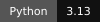 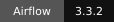 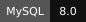 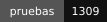   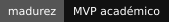 

[Documentación](docs/README.md) · [Análisis](docs/gold/resultados.md) · [Datos](data/) · [Guía de instalación](docs/instalacion/README.md)

Pipeline ETL con capas Bronze, Silver y Gold que integra una capa satelital de impacto en construcciones y el estrato socioeconómico por barrio, con una API de solo lectura, un panel, dos almacenes (SQLite y MySQL) y orquestación con Airflow.

## 1. Descripción y madurez
Estudiamos, con un indicador satelital, el cambio visible en **5.146 construcciones de 7 comunas de Cali** tras el sismo de magnitud 7,4 del 10 de agosto de 2026, y lo comparamos entre los estratos 1 a 6 del barrio. El proyecto descarga las fuentes abiertas, las guarda sin tocarlas (Bronze), las limpia y las une (Silver), calcula indicadores con intervalos de confianza (Gold) y los entrega por una API de solo lectura, un panel y dos bases de datos. El análisis completo, con su lectura y sus límites, está en [docs/gold/resultados.md](docs/gold/resultados.md).

**Madurez: MVP académico, ejecutable en local.** Lo que existe y se probó: el pipeline completo, la API, el panel, la carga a MySQL, el DAG en Airflow y phpMyAdmin de solo lectura. Lo que no existe: sesiones con personas usuarias (aún sin sesiones reales), despliegue en un servidor, integración continua, alertas externas y un repositorio publicado. Todo se probó en Windows 11 con PowerShell y Python 3.13.0; en otros sistemas no lo probamos.

**Resumen del resultado.** Con este proxy y esta muestra no se detecta diferencia en la proporción de construcciones con cambio satelital severo (severo estricto, proxy de daño) entre los estratos 3 a 5 y 1 a 2 (6,33 % frente a 5,84 %; diferencia +0,49 puntos porcentuales). Esto no equivale a decir que el estrato no influye: el indicador es un proxy y la muestra la definieron los polígonos de afectación.

### Alcance y límites de los resultados
Los tres recuadros siguientes son los mismos de [docs/gold/resultados.md](docs/gold/resultados.md) y de [docs/gold/KPIs.md](docs/gold/KPIs.md); una prueba comprueba que coincidan.

### Alcance temporal
> **Alcance temporal.** El estrato por barrio es de **2015** (DAPM Cali, medido en lados de manzana). Las construcciones se evaluaron con imágenes del **2026-03-22** y del **2026-08-11**, y la capa se editó por última vez el **2026-09-02** (`config/config.yaml`, sección `fechas`). Los polígonos de barrios que usamos para validar son de 2026 y están renumerados respecto a 2015 (H13, H18). Entre el estrato y las imágenes hay unos **once años** de distancia. **Regla de lectura:** los resultados por estrato describen el estrato de 2015 asignado al barrio, no el estrato vigente. Lo que cambió en los barrios entre 2015 y 2026 es **desconocido** para nosotros y no lo estimamos.

### Población analizada
> **Población analizada.** **5.146** construcciones (**4.711** con datos satelitales) de **7 comunas** de Cali (03, 09, 10, 17, 18, 19 y 20), repartidas en **52** códigos de barrio. Criterio de inclusión: la capa solo incluye construcciones dentro de los polígonos de afectación preliminar del visor de emergencia del IGAC, según la descripción del dataset. Quedan fuera las comunas ausentes, entre ellas la **Comuna 2** (la Alcaldía la mencionó entre las de mayor pérdida), y la zona rural. **Regla:** las tasas describen esta muestra; no se extrapolan a las construcciones de Cali ni a la ciudad.

### Indicador satelital frente a evaluación estructural
| aspecto | indicador satelital (este proyecto) | evaluación estructural (ATC-20, Alcaldía de Cali) |
|---|---|---|
| qué es | cambio de textura entre dos imágenes de satélite sobre la huella de la construcción; el severo estricto es la clase "Alta probabilidad de escombros" | inspección técnica en sitio que clasifica el predio con un sticker: rojo (inseguro), amarillo (uso restringido) o verde |
| quién lo produce | Fondo Adaptación (capa catalogada en datos.gov.co, `5vy8-gpw8`) | Alcaldía de Cali |
| cómo se obtiene | análisis de imágenes del 2026-03-22 y 2026-08-11, sin inspección directa | evaluación directa de cada predio |
| qué ve y qué no ve | ve cambio visible desde arriba; no ve daño interno ni daño sin cambio visible, y no da seguridad de uso | evalúa la seguridad de uso del predio; no tenemos sus datos por predio |
| unidad de análisis | construcción (huella catastral) | predio |
| cobertura | 5.146 construcciones de 7 comunas, dentro de los polígonos de afectación preliminar | 3.403 predios caracterizados (no conocemos su distribución por comuna) |
| cifras disponibles | 4.711 con datos satelitales; 296 severos estrictos (6,28 %) | 3.403 predios: 1.078 rojo, 1.272 amarillo y 1.053 verde, publicado por El País Cali el 23-sep-2026 (https://www.elpais.com.co/cali/alcaldia-de-cali-entrega-balance-de-gestion-tras-el-sismo-mas-de-3400-edificaciones-evaluadas-y-45000-familias-damnificadas-2338.html) |
| uso en este proyecto | es la base de todos los KPI de Gold | solo contexto: no se compara ni se mezcla con ninguna cifra de Gold |

Las cifras de la evaluación estructural son cifras reportadas por la prensa citando a la Alcaldía; no las cotejamos con una fuente oficial descargable. La unidad (predios) no es la nuestra (construcciones), por lo que no las comparamos ni las mezclamos con ninguna cifra de Gold.

## 2. Insignias
Las insignias están bajo el título. Cada valor sale de un archivo del repositorio y una prueba comprueba que coincida: Python de `requirements.txt`, Airflow del `Dockerfile` de `orquestacion/`, el número de pruebas de la recolección de pytest, la licencia de `LICENSE` y la fecha de la última verificación del manifiesto de evidencias. La última verificación es la fecha de [EV-100](docs/evidencias/modo_completo/EV-100_guia_seguida_desde_un_zip_nuevo.txt), la guía del modo completo seguida desde un zip nuevo; no es una ejecución automática. La cobertura es la de `src/` sin red, medida con la suite completa ([EV-114](docs/evidencias/readme/EV-114_cobertura_de_src_repetida.txt)); es una cota inferior porque parte del código se ejecuta en subprocesos que la medición no sigue. No hay insignias de integración continua porque no hay integración continua (sección 12).

## 3. Tabla de contenidos
- [1. Descripción y madurez](#1-descripción-y-madurez)
- [2. Insignias](#2-insignias)
- [3. Tabla de contenidos](#3-tabla-de-contenidos)
- [4. Arquitectura](#4-arquitectura)
- [5. Stack tecnológico](#5-stack-tecnológico)
- [6. Estructura del repositorio](#6-estructura-del-repositorio)
- [7. Requisitos e instalación](#7-requisitos-e-instalación)
- [8. Ejecución del pipeline](#8-ejecución-del-pipeline)
- [9. Diseño de datos y contratos](#9-diseño-de-datos-y-contratos)
- [10. Calidad y pruebas](#10-calidad-y-pruebas)
- [11. Observabilidad](#11-observabilidad)
- [12. Despliegue e integración continua](#12-despliegue-e-integración-continua)
- [13. Errores, reintentos y recuperación](#13-errores-reintentos-y-recuperación)
- [14. Seguridad](#14-seguridad)
- [15. Rendimiento y costos](#15-rendimiento-y-costos)
- [16. Decisiones de arquitectura](#16-decisiones-de-arquitectura)
- [17. Contribución y estándares](#17-contribución-y-estándares)
- [18. Estado y hoja de ruta](#18-estado-y-hoja-de-ruta)
- [19. Contacto y responsables](#19-contacto-y-responsables)
- [20. Licencia y créditos](#20-licencia-y-créditos)

## 4. Arquitectura
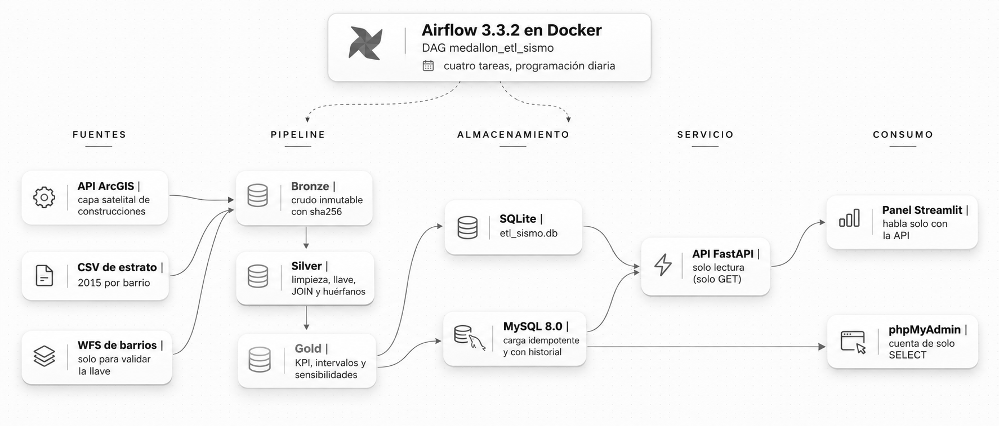

*Figura 1. Muestra cómo las tres fuentes llegan a Bronze, cómo pasan por Silver y Gold, dónde se almacenan los resultados, quién los consume y qué orquesta Airflow.*

La extracción de Bronze se ejecuta con `main.py`, fuera del DAG: el DAG parte de un Bronze ya descargado y lo valida. Airflow también levanta, en su compose, una base Postgres y un Redis que el diagrama no dibuja (los usa el propio Airflow para sus metadatos y su cola).

| Capa | Entra | Qué se hace | Sale |
|---|---|---|---|
| **Bronze** | la capa ArcGIS (API), el CSV de estrato y los polígonos de barrios | se guarda tal como llegó, con sha256 y manifiesto; nunca se sobrescribe | `data/bronze/manifest.jsonl` y las respuestas crudas |
| **Silver** | Bronze, solo lectura | duplicados, nulos, tipos, llave del JOIN, JOIN y validación de calidad | `data/silver/` con cinco tablas y `quality_report.json` |
| **Gold** | `silver_integrated.csv`, nunca Bronze | indicadores K1 a K6, intervalos, cotas y sensibilidades S0 a S5 | `data/gold/` con tres CSV y `etl_sismo.db` |
| **Servicio** | Gold, en SQLite o MySQL | API de solo lectura y panel que habla solo con la API | JSON y páginas web locales |

Los servicios locales escuchan solo en `127.0.0.1`:

| Servicio | Puerto | Para qué |
|---|---|---|
| API (FastAPI) | 8000 | resultados de Gold por HTTP, solo GET |
| Panel (Streamlit) | 8501 | las ocho páginas de lectura |
| Airflow | 8080 | interfaz del DAG |
| phpMyAdmin | 8081 | ver las tablas de MySQL con una cuenta de solo lectura |

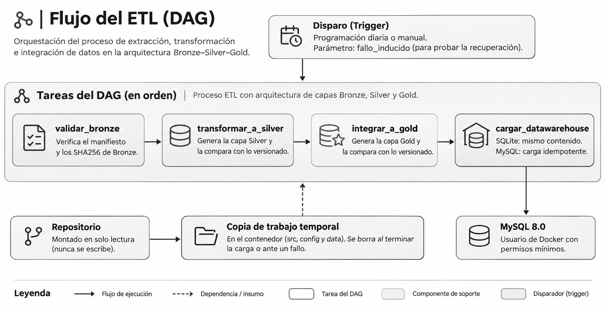

*Figura 2. Muestra el disparo del DAG, sus cuatro tareas en orden y cómo trabajan sobre una copia temporal sin escribir en el repositorio.*

Detalle por componente: [API](docs/api/arquitectura.md), [panel](docs/panel/arquitectura_panel.md), [orquestación](docs/orquestacion/README.md) y [modelo de datos](docs/almacenamiento/modelo_datos.md).

**Calidad, linaje y monitoreo.** La calidad vive en `data/silver/quality_report.json` y en las pruebas de `tests/`. El linaje, en el manifiesto de Bronze con el sha256 de cada archivo y en la trazabilidad de [docs/checklist/trazabilidad.md](docs/checklist/trazabilidad.md). El monitoreo, en los registros de `logs/`, en `/health` y `/calidad` de la API y en la interfaz de Airflow. No hay un servicio aparte para ninguno de los tres.

## 5. Stack tecnológico
Las versiones son las de `requirements.txt`, `orquestacion/Dockerfile` y los compose; una prueba comprueba que esta tabla coincida con ellos.

**Extracción**

| Componente | Versión | Para qué lo elegimos |
|---|---|---|
| `requests` | 2.34.2 | descarga con reintentos de la capa ArcGIS, del CSV y de los polígonos |
| `openpyxl` | 3.1.5 | lector de Excel del módulo tabular; hoy la fuente es un CSV y el lector admite los dos formatos |

**Orquestación**

| Componente | Versión | Para qué lo elegimos |
|---|---|---|
| Airflow | 3.3.2 | orquestación con CeleryExecutor, en Docker |
| Postgres | 16 | metadatos de Airflow (imagen fijada por digest) |
| Redis | 7.2 | cola de Airflow (imagen fijada por digest) |

**Transformación**

| Componente | Versión | Para qué lo elegimos |
|---|---|---|
| Python | 3.13 | única versión con la que se fijaron las salidas de la línea base |
| `pandas` | 3.0.6 | limpieza y cálculo; con otra versión cambian celdas de la línea base (D56) |
| `numpy` | 2.5.4 | cálculo numérico |
| `shapely` | 2.2.0 | punto en polígono local para validar la llave (D5) |

**Almacenamiento**

| Componente | Versión | Para qué lo elegimos |
|---|---|---|
| SQLite | incluido en Python | recalcular los indicadores con SQL de forma independiente (D10) |
| MySQL | 8.0 | almacén relacional con historial de cargas; se verificó en vivo con 8.0.45 |
| `pymysql` | 1.2.4 | carga relacional a MySQL |

**Servicio y consumo**

| Componente | Versión | Para qué lo elegimos |
|---|---|---|
| `fastapi` | 0.162.7 | API tipada y documentada de solo lectura |
| `pydantic` | 2.14.3 | contratos de respuesta de la API |
| `uvicorn` | 0.54.0 | servidor de la API |
| `streamlit` | 1.67.0 | panel sobre la API (D20) |
| `altair` | 6.3.0 | gráficos del panel |
| phpMyAdmin | 5.2.3 | ver las tablas de forma segura (imagen fijada por digest) |

**Calidad**

| Componente | Versión | Para qué lo elegimos |
|---|---|---|
| `pytest` | 9.2.0 | pruebas |
| `coverage` | 7.17.3 | cobertura de `src/` |
| `jupyter` | 1.1.1 | los cinco notebooks de análisis y validación, entre ellos el recálculo independiente |

Decisión de alcance: calidad con `pytest` y `quality_report.json`. No usamos herramientas externas de calidad de datos ni de transformación declarativa (por ejemplo Great Expectations o dbt): las reglas de Silver viven en el código y cada una tiene su prueba.

**Observabilidad.** El módulo `logging` de la biblioteca estándar de Python (`src/logger.py`), la interfaz de Airflow y `/health` de la API. No usamos herramientas externas (sección 11).

**Infraestructura y apoyo**

| Componente | Versión | Para qué lo elegimos |
|---|---|---|
| `pyyaml` | 6.0.3 | lectura de `config/config.yaml` |
| `python-dotenv` | 1.2.4 | lectura de `.env` |
| `matplotlib` | 3.11.2 | gráficos de evidencias y diagramas propios |
| `pillow` | 13.0.0 | copias en escala de grises de las imágenes del README |

Docker Desktop con WSL2 se usó solo para Airflow y phpMyAdmin (Docker 29.9.3 y Compose 5.7.0 en la última prueba completa, [EV-100](docs/evidencias/modo_completo/EV-100_guia_seguida_desde_un_zip_nuevo.txt)).

## 6. Estructura del repositorio
```
.
├── main.py                   # punto de entrada: --stage extract, transform, gold o all, y --refresh
├── requirements.txt          # dependencias con versión exacta (Python 3.13)
├── pytest.ini                # configuración de las pruebas
├── .env.example              # nombres de las variables de entorno, sin valores
├── LICENSE                   # licencia MIT del código
├── config/
│   ├── config.yaml           # fuentes, umbrales, fechas, rutas, registro de ejecución, API y panel
│   └── parametros_costos.yaml  # precios como parámetros vacíos
├── data/
│   ├── bronze/               # respuestas crudas, CSV original, polígonos y manifest.jsonl
│   ├── silver/               # tablas limpias, huérfanos y quality_report.json
│   └── gold/                 # gold_final.csv, kpis_gold.csv, kpis_sensibilidad.csv y etl_sismo.db
├── src/
│   ├── extract/              # descarga paginada y snapshots de Bronze
│   ├── transform/            # limpieza, llave, JOIN y Gold
│   ├── load/                 # carga a SQLite y carga relacional a MySQL (esquemas en sql/)
│   ├── api/                  # API de solo lectura
│   ├── panel/                # panel Streamlit (páginas en paginas/)
│   ├── common.py             # configuración, manifiesto y sha256
│   └── logger.py             # registro de ejecución con enmascarado de secretos
├── tests/                    # pruebas automáticas
├── scripts/                  # utilidades (ver scripts/README.md)
│   ├── mysql/                # configurar las cuentas y verificar MySQL
│   ├── orquestacion/         # preparar y sincronizar Airflow
│   ├── panel/                # lanzador de la API y el panel
│   ├── usuarios/             # análisis de sesiones con personas usuarias
│   ├── validacion/           # regresiones e igualdad de código
│   ├── finanzas/             # medición de recursos
│   └── evidencias/           # scripts que producen evidencias
├── dags/
│   └── medallon_etl_dag.py   # el DAG medallon_etl_sismo
├── orquestacion/             # Dockerfile, compose de Airflow y requisitos de su imagen
├── servicios/
│   └── phpmyadmin/           # compose de phpMyAdmin de solo lectura
├── notebooks/                # cinco notebooks: conexión, exploración, Silver, Gold y validación
└── docs/
    ├── README.md             # índice y tabla «dónde está cada cosa»
    ├── DECISIONES.md         # decisiones con alternativas, razón y riesgo
    ├── almacenamiento/       # modelo relacional, configuración de MySQL, phpMyAdmin y carga
    ├── api/                  # arquitectura del backend
    ├── arquitectura/         # documento de arquitectura del sistema y registros de decisión (ADR)
    ├── bronze/               # fuentes, catálogo, atribución y muestras
    ├── checklist/            # estado y trazabilidad de los ítems
    ├── diagramas/            # diagramas en color aportados y diagramas con fuente en texto
    ├── estrategia/           # estrategia, objetivo, canvas y MVP
    ├── evidencias/           # manifiesto y evidencias con sha256
    ├── finanzas/             # estructura de costos y recursos medidos
    ├── gold/                 # definición de los indicadores y resultados
    ├── img/                  # insignias y copias de las imágenes del README
    ├── instalacion/          # guías de instalación
    ├── orquestacion/         # Airflow: diferencias con la guía y operación
    ├── panel/                # arquitectura, guía y pruebas del panel
    ├── proyecto/             # contexto, entorno y decisiones técnicas
    ├── retroalimentacion/    # retroalimentación recibida y cómo se atendió
    ├── seguridad/            # gestión de credenciales
    ├── silver/               # hallazgos, reglas y validación de la llave
    ├── usuarios/             # material y análisis de sesiones con personas usuarias
    └── validacion/           # matriz de casos, informe de pruebas y registro de defectos
```

No se versionan los archivos `.log` de `logs/`, ni `dist/`, `.venv/` ni `.env`.

## 7. Requisitos e instalación
| Requisito | Para qué | Cómo comprobarlo |
|---|---|---|
| Windows 11 | es donde se probó todo | n. a. |
| Python 3.13 instalado en paralelo | las versiones fijadas se probaron con él | `py -0p` debe listar 3.13 |
| Git (opcional) | clonar; con el zip no hace falta, pero algunas pruebas lo usan | `git --version` |
| MySQL 8.0 (solo modo completo) | carga relacional | el servicio `MySQL80` activo |
| Docker Desktop con WSL2 (solo modo completo) | Airflow y phpMyAdmin | `docker version` |

La ruta de la carpeta debe tener menos de unos 120 caracteres: Windows corta las rutas completas en 260 y el archivo más largo del repositorio tiene 130 de ruta relativa. Los espacios y las tildes en el nombre de la carpeta no dan problema.

Hay dos modos. El **modo mínimo** (pipeline, API, panel y pruebas con SQLite) basta para reproducir las cifras. El **modo completo** agrega MySQL, Airflow y phpMyAdmin y no cambia ninguna cifra. Las guías son [docs/instalacion/README.md](docs/instalacion/README.md), [modo mínimo](docs/instalacion/modo_minimo.md) y [modo completo paso a paso](docs/instalacion/guia_modo_completo.md).

### Primera vez en el modo mínimo
Desde la raíz del proyecto, en PowerShell:
```powershell
py -3.13 scripts\preparar_entorno.py                   # diagnóstico de solo lectura
py -3.13 -m venv .venv
.\.venv\Scripts\Activate.ps1
python -m pip install -r requirements.txt
python main.py --stage all
python -m pytest -q -p no:cacheprovider
python scripts\panel\ejecutar_panel.py                  # API en 8000 y panel en 8501; Ctrl+C cierra los dos
```
Qué debe verse: `python main.py --stage all` termina con líneas como `Salida: construcciones=5146 barrios=346 integrado=5146 | cobertura de llave=99.8834% (pasa)` y `Salida: gold_final=5146 filas | kpis_gold=23 filas (6 indicadores) | sensibilidades=107 filas`; las pruebas terminan con `1375 passed`. El pipeline no necesita red ni claves, porque Bronze ya está en el repositorio. El archivo `.env` se crea al configurar el modo completo y nunca se versiona; `.env.example` trae solo los nombres de sus 12 variables y la tabla siguiente dice para qué sirve cada una (nunca valores):

| Variable | Para qué sirve | Obligatoria | Modo |
|---|---|---|---|
| `HTTP_USER_AGENT` | identificación de las descargas; si falta se usa una genérica | no | mínimo y completo, solo al descargar con red (`--refresh`) |
| `MYSQL_HOST` | servidor de MySQL | sí, si se usa MySQL | completo |
| `MYSQL_PORT` | puerto de MySQL | sí, si se usa MySQL | completo |
| `MYSQL_USER` | cuenta de la carga y de la API con MySQL | sí, si se usa MySQL | completo |
| `MYSQL_PASSWORD` | contraseña de esa cuenta; la genera el script de configuración | sí, si se usa MySQL | completo |
| `MYSQL_DATABASE` | base de datos real | sí, si se usa MySQL | completo |
| `MYSQL_DATABASE_PRUEBA` | base para las verificaciones destructivas | sí, para verificar MySQL | completo |
| `MYSQL_DOCKER_USER` | cuenta de la tarea de carga del DAG | sí, si se usa Airflow | completo |
| `MYSQL_DOCKER_PASSWORD` | contraseña de esa cuenta; la genera el script de configuración | sí, si se usa Airflow | completo |
| `MYSQL_DOCKER_ORIGEN` | origen desde el que se conecta esa cuenta; lo escribe el script de configuración | sí, si se usa Airflow | completo |
| `MYSQL_LECTURA_USER` | cuenta de solo lectura para phpMyAdmin | sí, si se usa phpMyAdmin | completo |
| `MYSQL_LECTURA_PASSWORD` | contraseña de esa cuenta; la genera el script de configuración | sí, si se usa phpMyAdmin | completo |

Tiempos medidos, todos de una máquina de desarrollo con Windows 11 y 15,7 GB de RAM; en otro equipo cambian y no los prometemos:

| Qué | Tiempo | Origen | Fecha |
|---|---|---|---|
| Crear el entorno virtual e instalar `requirements.txt` | 311 s (13,9 s el entorno y 296,8 s `pip install`) | [EV-113](docs/evidencias/readme/EV-113_primera_vez_y_suite_en_clon_y_zip.txt); antes, 251 s en [EV-100](docs/evidencias/modo_completo/EV-100_guia_seguida_desde_un_zip_nuevo.txt) y 288 s en [EV-083](docs/evidencias/servicios/EV-083_suite_sin_utf8_antes.txt) | 2026-11-16 |
| `python main.py --stage all` | 10,3 s la primera vez; mediana de 3 repeticiones: 2,9 s y 148 MB de pico | EV-113 | 2026-11-16 |
| Suite completa en el clon | de 343 s a 409 s con 1.330 pruebas (dos pasadas) y de 323 a 452 MiB de pico | EV-113 | 2026-11-16 |
| Suite completa en el zip descomprimido | de 267 s a 358 s con 1.329 pruebas y 1 omitida (dos pasadas) | EV-113 | 2026-11-16 |
| API y panel con `ejecutar_panel.py` | la API responde a los 2,2 s y el panel a los 5,4 s | EV-113 | 2026-11-16 |
| `docker compose build` de Airflow | 8,9 s | EV-100, primera pasada | 2026-11-16 |
| `docker compose up airflow-init` | 42,2 s | EV-100, primera pasada | 2026-11-16 |
| `docker compose up -d` de Airflow | 55 s | EV-100, primera pasada | 2026-11-16 |
| Las cuatro tareas del DAG | unos 12 s | EV-100 | 2026-11-16 |

Los tiempos de Docker son de EV-100 y no se volvieron a medir hoy, porque no se usó Docker; son de una máquina que ya tenía Docker, MySQL y las imágenes descargadas, y en una máquina limpia serán mayores. Lo que se ejecutó hoy en un clon nuevo es el modo mínimo; lo que necesita Docker o MySQL no se verificó hoy y lo respalda EV-100. No decimos cuánto tarda una persona en total porque depende de la conexión y de cada equipo.

### Modo completo en resumen
Con el modo mínimo funcionando, el modo completo agrega, en este orden: las tres cuentas de MySQL (`.\.venv\Scripts\python.exe scripts\mysql\configurar_mysql.py`, con sus opciones `--usuario-docker` y `--usuario-lectura`; cada una pide la contraseña del administrador por teclado y guarda las credenciales solo en `.env`), la carga a MySQL, la carpeta de Airflow (`scripts\orquestacion\preparar_airflow.py`) con `docker compose build`, `docker compose up airflow-init` y `docker compose up -d`, y phpMyAdmin. La guía con lo que debe verse en cada comando y los errores comunes está en [docs/instalacion/guia_modo_completo.md](docs/instalacion/guia_modo_completo.md).

## 8. Ejecución del pipeline
Hay un solo entorno, el local (la máquina de quien lo ejecuta): no hay staging ni producción.

```powershell
python main.py --stage all                  # Bronze, Silver y Gold
python main.py --stage extract              # solo Bronze
python main.py --stage transform            # solo Silver
python main.py --stage gold                 # solo Gold y la carga a SQLite
python main.py --stage extract --refresh    # snapshot nuevo de Bronze (necesita red)
```
Con Bronze presente, `--stage extract` verifica los sha256 y escribe «ya existe, sha256 coincide»: no descarga ni agrega líneas al manifiesto. Con `--refresh` crea un snapshot nuevo sin tocar el anterior; después hay que volver a ejecutar `--stage transform` y `--stage gold`, y los resultados pueden cambiar si la fuente cambió.

**No existe un modo de simulación (dry-run).** `--stage all` escribe en `data/silver/` y `data/gold/`. Aunque los datos salgan iguales, `git status` puede mostrar dos cambios: `data/gold/etl_sismo.db` (SQLite no escribe el archivo igual byte a byte en cada carga; cambian los bytes, no las tablas) y una línea de `docs/silver/reglas_silver.md`. Para volver a lo versionado: `git checkout -- data/gold/etl_sismo.db docs/silver/reglas_silver.md`. Lo más parecido a una ejecución sin riesgo es el DAG de Airflow, que trabaja en una copia y compara con lo versionado sin escribir en el repositorio.

**Con Airflow** (desde la carpeta de Airflow que prepara el script, no desde la del proyecto):
```powershell
docker compose exec airflow-scheduler airflow dags unpause medallon_etl_sismo
docker compose exec airflow-scheduler airflow dags trigger medallon_etl_sismo
docker compose exec airflow-scheduler airflow dags list-runs medallon_etl_sismo
```
El DAG `medallon_etl_sismo` tiene cuatro tareas, `validar_bronze`, `transformar_a_silver`, `integrar_a_gold` y `cargar_datawarehouse`, se programa a las 06:00 hora de Bogotá (`0 6 * * *`) y no recupera ejecuciones pasadas (`catchup=False`). Para probar la recuperación, `airflow dags trigger medallon_etl_sismo --conf '{"fallo_inducido":"integrar_a_gold"}'` hace fallar esa tarea antes de producir salidas.

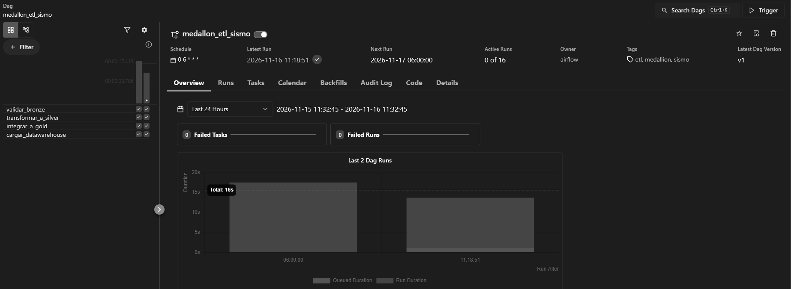

*Figura 3. Muestra el DAG con sus cuatro tareas y su programación, sin tareas fallidas.*

**API y panel:**
```powershell
python -m uvicorn src.api.app:app --host 127.0.0.1 --port 8000
python -m streamlit run src/panel/app.py
python scripts\panel\ejecutar_panel.py --almacenamiento mysql    # con la API sirviendo desde MySQL
```
La API tiene **11 rutas GET**: `/calidad`, `/composicion`, `/comunas`, `/construcciones`, `/fuentes`, `/health`, `/kpis`, `/kpis/sensibilidad`, `/kpis/{kpi_id}`, `/llave/revision` y `/metadata`. Su documentación automática queda en `http://127.0.0.1:8000/docs`. El panel tiene **8 páginas y 28 componentes**, todas con el recuadro de alcance. Guía de uso: [docs/panel/guia_de_uso.md](docs/panel/guia_de_uso.md).

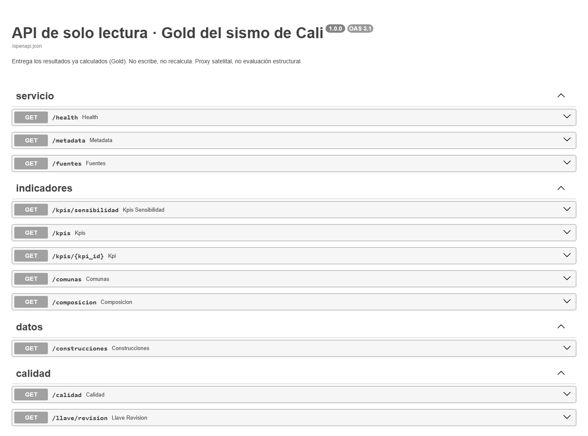

*Figura 4. Muestra la lista de rutas de la API de solo lectura.*

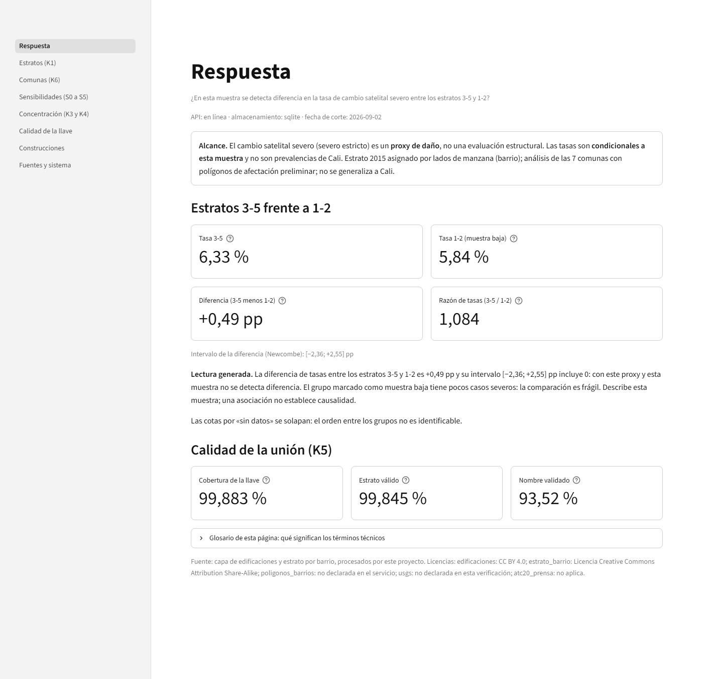

*Figura 5. Muestra la página Respuesta del panel con su recuadro de alcance.*

**Carga a MySQL:**
```powershell
.\.venv\Scripts\python.exe scripts\cargar_mysql.py --destino mysql
.\.venv\Scripts\python.exe scripts\mysql\verificar_mysql.py
```

## 9. Diseño de datos y contratos
**Bronze.** Cada petición se guarda byte a byte y `data/bronze/manifest.jsonl` registra una línea por archivo (8 en total) con `source_id`, `url`, `params`, `fetched_at_utc`, `http_status`, `rows`, `bytes`, `sha256` y `path`. Los archivos se abren en modo exclusivo, así que ninguno se sobrescribe. Las tres fuentes y sus términos están en [docs/bronze/catalogo_fuentes_metadatos.md](docs/bronze/catalogo_fuentes_metadatos.md).

**Silver.** 18 reglas (R01 a R18) en [docs/silver/reglas_silver.md](docs/silver/reglas_silver.md); cada una cita el hallazgo del análisis exploratorio que la justifica. La llave del JOIN es el código catastral, `int(COMUNA)*100 + int(BARRIO)` como texto, y no un nombre de barrio. Los huérfanos se guardan en archivos aparte, no se descartan. Los umbrales de calidad (por ejemplo `join_coverage_min`) están en `config/config.yaml` y `quality_report.json` registra lo medido.

**Gold.** `gold_final.csv` tiene una fila por construcción (5.146) y su diccionario de columnas está en [docs/gold/KPIs.md](docs/gold/KPIs.md), junto con la definición de cada indicador. `kpis_gold.csv` tiene 23 filas (K1 a K6) y `kpis_sensibilidad.csv` tiene 107 (escenarios S0 a S5).

**Almacenes.** SQLite (`data/gold/etl_sismo.db`) tiene 4 tablas: `silver_integrated`, `gold_final`, `kpis_gold` y `kpis_sensibilidad`. MySQL tiene 7 tablas con claves primarias y foráneas, restricciones de validación e historial: `corrida`, `corrida_archivo`, `comuna`, `barrio_estrato`, `construccion`, `kpi` y `kpi_sensibilidad`. Cada carga distinta es una corrida completa; las anteriores no se tocan. Modelo: [docs/almacenamiento/modelo_datos.md](docs/almacenamiento/modelo_datos.md).

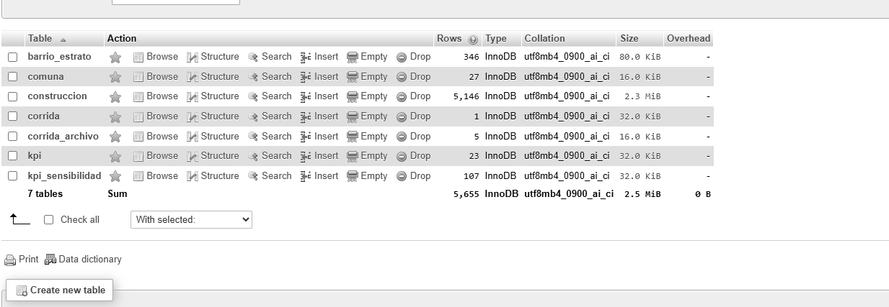

*Figura 6. Muestra las siete tablas de MySQL con sus filas.*

**Contratos.** No usamos un registro de esquemas externo. Los contratos son cuatro y cada uno tiene pruebas:

| Contrato | Dónde vive | Qué comprueban las pruebas |
|---|---|---|
| Respuestas de la API | modelos pydantic de `src/api/esquemas.py` | estructura, validación de parámetros y coincidencia con las salidas |
| Esquemas SQL | `src/load/sql/esquema_mysql.sql` y `src/load/sql/esquema_sqlite.sql` | paridad entre los dos y con el diccionario de datos |
| Calidad de Silver | `quality_report.json` y los umbrales de `config/config.yaml` | campos del reporte, cobertura frente al umbral, mínimo de filas |
| Salidas del pipeline | los nueve archivos de la línea base con sha256 | que regenerarlos reproduce los mismos bytes |

**Convenciones de nombres.** Las tablas y los archivos de Silver llevan el prefijo `silver_` (`silver_integrated`); Gold se llama `gold_final`, `kpis_gold` y `kpis_sensibilidad`; las tablas de MySQL van en minúsculas y en singular (`construccion`, `corrida`). Los indicadores son K1 a K6, los escenarios S0 a S5, los hallazgos H1 a H18 y las reglas R01 a R18; los defectos, DEF-nnn; las decisiones, D nnn (la última, D106); los casos de prueba, CP-nnn, y las evidencias, EV-nnn.

**Estrategia de carga.** Cada ejecución regenera Silver y Gold completos desde Bronze y reemplaza las tablas de `etl_sismo.db`; no hay carga incremental ni historial de cambios por registro (SCD). En MySQL, cada carga con una entrada distinta es una corrida completa que se suma a las anteriores, y repetir la misma entrada responde «ya cargada» sin escribir.

**Frescura de los datos.** No hay un acuerdo de nivel de servicio de frescura: los datos son una captura única, descargada el 2026-10-15 (hora de Bogotá), y no se actualizan solos. La fecha de corte, que es la de la última edición de la capa (2026-09-02), la entrega `/health`.

**Umbrales de calidad.** Algunos de los que fija `config/config.yaml`, con su valor:

| Parámetro | Valor | Qué controla |
|---|---|---|
| `thresholds.join_coverage_min` | 0.80 | cobertura mínima de la llave del JOIN |
| `thresholds.gold_min_rows` | 200 | filas mínimas de Gold |
| `thresholds.min_edificios_por_barrio` | 10 | construcciones con datos que exige K4 a cada barrio |
| `silver.muestra_baja_severos` | 30 | severos por debajo de los cuales un grupo se marca de muestra baja |

## 10. Calidad y pruebas
Hay **1375 pruebas** automáticas, sin red ni servidor MySQL. Se ejecutan con `python -m pytest -q -p no:cacheprovider` y deben terminar con `1375 passed` en un clon con Git instalado; en un clon con Git no se omite ninguna; en el zip descomprimido con Git se omite 1 (`test_sin_hallazgos_en_el_historial_de_git`, porque el zip no trae historial) y sin Git se omiten 10: esa, 8 que arman un repositorio temporal y 1 que arma el zip y corre las demás. La lista está en la sección 3.1 de [docs/instalacion/README.md](docs/instalacion/README.md), medida con 1.007 pruebas ([EV-096](docs/evidencias/auditoria/EV-096_independencia_repetida_y_omisiones.txt)).

- **Qué cubren:** el pipeline (llaves, duplicados, tipos, Wilson, Newcombe, Mantel-Haenszel), la reproducción byte a byte de la línea base, la API (estructura, solo GET, sin escritura), el panel (las ocho páginas con la API real en memoria, formato de cifras, aislamiento), la carga relacional (idempotencia, historial, reversión, integridad referencial), el DAG y los compose analizados como texto, el empaquetado y la gestión de secretos.
- **Las cifras de los documentos se prueban contra las salidas.** Este README, el documento de resultados y la guía de instalación afirman cifras; una prueba extrae cada una del texto y la compara con la medida. Si alguien edita una cifra, o la deja desactualizada en un solo lugar, la prueba falla.
- **Recálculo independiente:** el notebook `notebooks/04_gold_kpis.ipynb` recalcula los indicadores con SQL sobre SQLite y con implementaciones propias de Wilson, Newcombe, Mantel-Haenszel y Spearman; la diferencia máxima es inferior a 1e-9. Ese recálculo detectó un defecto real de Mantel-Haenszel (se contaban construcciones sin datos satelitales en los tamaños de grupo), que se corrigió y quedó fijado por una prueba.
- **Defectos:** **25 defectos** registrados (DEF-001 a DEF-025), cada uno con su causa, su corrección y la prueba o comprobación que lo vigila ([docs/validacion/registro_defectos.md](docs/validacion/registro_defectos.md)). Para 15 se demostró que su prueba de regresión falla sin la corrección, reintroduciendo el defecto en una copia ([EV-036](docs/evidencias/orquestacion/EV-036_regresiones_sin_correccion.txt) y [EV-104](docs/evidencias/modo_completo/EV-104_regresiones_def017_a_def021.txt)). Para los otros 10 no se demostró (DEF-003, DEF-006, DEF-009, DEF-010, DEF-011, DEF-014 y DEF-022 a DEF-025) y el registro da el motivo de cada uno: dependen del entorno, de un servidor MySQL, de una versión de pandas, del dibujo de una captura o de que la prueba no puede reintroducir el defecto por reemplazo de texto.
- **Mutaciones:** [EV-103](docs/evidencias/modo_completo/EV-103_mutaciones_modo_completo.txt) registra 132 mutaciones en total, todas detectadas, el 2026-11-16; la tabla siguiente las descompone. Una mutación cambia a propósito un archivo en un clon del repositorio, corre las pruebas indicadas y debe hacer fallar al menos una; después se restaura el clon. Lo que se prueba son las pruebas del modo completo, no los datos. Quedaron como registro de lo que se probó ese día; no hay un comando único que las repita.
- **Cobertura:** 78 % de las líneas de `src/`, medida sin red con la suite completa el 2026-11-16 ([EV-114](docs/evidencias/readme/EV-114_cobertura_de_src_repetida.txt)). No es una cota exacta: `extract_api.py` necesita red y dos módulos se ejercen en subprocesos que no se miden.
- **Si se incumple un umbral** (verificado en el código): con `thresholds.join_coverage_min` la transformación no se detiene; `quality_report.json` registra `resultado_umbral: no pasa`, se escribe un aviso `WARNING` cuando la cobertura queda a menos de 0,05 del umbral y la prueba `test_cobertura_join_supera_umbral` falla si el reporte versionado dice `no pasa`. Con `thresholds.gold_min_rows` la etapa Gold se detiene con el error «Gold por debajo del mínimo». Con `silver.muestra_baja_severos` el grupo solo se marca como de muestra baja y se escribe un aviso. `thresholds.min_edificios_por_barrio` no avisa: deja fuera de K4 a los barrios con menos construcciones con datos.
- **Matriz de casos e informe:** [matriz de casos](docs/validacion/matriz_casos_prueba.md) por función crítica e [informe de pruebas](docs/validacion/informe_pruebas.md), generados con `python scripts\make_matriz_casos.py` y `python scripts\informe_pruebas.py`.
- **Evidencias:** cada afirmación de los documentos que se apoya en una ejecución tiene una evidencia con su sha256 en [docs/evidencias/manifiesto.md](docs/evidencias/manifiesto.md).

| Parte de EV-103 | Qué se muta | Mutaciones |
|---|---|---|
| Parte 1 | el `.env` y el escáner de secretos sin repositorio de Git, y el nombre de proyecto de Compose (D102 y D103) | 43 |
| Parte 2 | el `chown` de `airflow-init`, que salta el proyecto montado (DF-19) | 9 |
| Parte 3 | `airflow db check` en `airflow-init` (DF-20) | 17 |
| Parte 4 | la guía del modo completo y las reglas de su prueba guardiana: daños al texto de la guía y reglas debilitadas | 63 |
| Total | las cuatro partes | 132 |

Lo que no hay: pruebas de carga, de fuzzing ni de otro sistema operativo distinto de Windows 11.

## 11. Observabilidad
- **Registro de ejecución:** cada ejecución escribe en consola y en `logs\etl_AAAAMMDD.log` con el formato `fecha hora NIVEL módulo mensaje`. Cada etapa registra su inicio, su duración y las filas de entrada y de salida. Los avisos de calidad usan `WARNING` y `ERROR` solo aparece si algo falla. Un filtro oculta tokens, cabeceras de autenticación y valores de `.env`. Se configura en la sección `logging` de `config/config.yaml`.
- **Estado del servicio:** la API responde `/health` (estado, fecha de corte y filas por tabla) y `/calidad` (coberturas y confianza de la llave).
- **Calidad de los datos:** `data/silver/quality_report.json` con las coberturas y las banderas de cada regla.
- **Orquestación:** la interfaz de Airflow muestra el estado de cada tarea y la duración de cada ejecución.
- **Linaje:** el manifiesto de Bronze liga cada archivo con su URL, su fecha y su sha256; cada regla de Silver cita el hallazgo que la justifica; y la trazabilidad por ítem enlaza archivos, pruebas y evidencias ([docs/checklist/trazabilidad.md](docs/checklist/trazabilidad.md)).
- **Impacto de un cambio:** `tests/test_pipeline_reproducible.py` compara en una copia los nueve archivos de la línea base con lo regenerado, así que un cambio que altere una salida se ve como una diferencia de sha256; después se busca el archivo cambiado en la trazabilidad para saber qué ítems, pruebas y evidencias lo citan, y `python scripts\validar_checklist.py --todos` comprueba que siguen en pie. No hay una herramienta que dibuje el grafo de dependencias.
- **Registros:** un archivo por día; no hay rotación ni borrado automático y los `.log` no se versionan.

Decidimos no incluir alertas ni métricas externas (Slack, PagerDuty, Prometheus): el proyecto corre en una máquina local, sin un servicio desplegado que alguien deba vigilar. Si se despliega, esta sección es la primera que habría que ampliar.

## 12. Despliegue e integración continua
**No hay despliegue en un servidor ni integración continua.** Existe un solo entorno, el local; no hay staging ni producción. Tampoco hay repositorio remoto publicado, así que no hay flujos automáticos. Lo que sí hay es un procedimiento manual que se repite igual cada vez:

1. Las pruebas completas en un clon y en el zip.
2. `python scripts\make_dist.py` arma el zip por lista de inclusión: nunca entran `.env`, `.git`, `.venv`, `logs` ni `dist`.
3. `python scripts\orquestacion\sincronizar_dag.py --verificar` comprueba que el DAG versionado y el DAG de Airflow son idénticos (su hash está fijado en `orquestacion/dag.sha256`).
4. `python scripts\escanear_secretos.py` debe terminar en `hallazgos: 0`.
5. Etiquetas de Git por componente marcan cada cierre.

Docker se usa solo para Airflow y phpMyAdmin; el pipeline, la API y el panel corren con Python en la máquina.

## 13. Errores, reintentos y recuperación
- **Descargas:** `requests` hace hasta 3 intentos por petición (reintenta si falla la conexión o la respuesta es 5xx), con una pausa de 0,5 s, 1 s y 1,5 s después de cada intento fallido, y espera como máximo 30 s por intento a que el servidor conteste (`timeout_s` de `config/config.yaml`, sección `http`, que acota la conexión y la espera de datos, no el tiempo total). Una extracción se considera completa solo si existe el conteo posterior de la capa.
- **Bronze corrupto o alterado:** el manifiesto trae el sha256 de cada archivo; la tarea `validar_bronze` del DAG falla si alguno no coincide y las tareas siguientes no se ejecutan.
- **Silver y Gold:** se regeneran desde Bronze y una prueba comprueba que, en una copia, reproducen byte a byte los nueve archivos de la línea base. Los datos dudosos no se descartan: los duplicados de geometría se marcan, los huérfanos se guardan en archivos aparte y los nulos no se imputan.
- **Idempotencia:** repetir `--stage extract` no duplica nada; la carga a MySQL responde «ya cargada» cuando la entrada es la misma y no escribe. Cada carga distinta ocurre en una sola transacción: si algo falla, no queda nada a medias.
- **Airflow:** el DAG no tiene reintentos de tareas (el valor por omisión es 0) y `catchup=False`. La carga a MySQL depende de un servicio que está fuera del repositorio, el MySQL del equipo; si no responde, la tarea falla y hay que volver a lanzarla. Ante un fallo, cada tarea borra su copia de trabajo. El fallo inducido (`fallo_inducido`) permite comprobar esa recuperación ([EV-042](docs/evidencias/orquestacion/EV-042_fallo_inducido_y_recuperacion.txt)).
- **Si la fuente cambia de esquema:** no hay una validación explícita de columnas ni una prueba que simule ese cambio, y no podemos afirmar qué mensaje daría una columna que falte o cambie de nombre. Lo que sí existe: la extracción guarda el metadato de la capa (`capa_meta.json`, con sus campos) y los conteos antes y después de descargar, y las pruebas de Bronze comprueban que las páginas sumen el conteo oficial; Silver se detiene si aparece una etiqueta de `Estado_Estructural` que no conoce, si `OBJECTID` o el código de barrio dejan de ser únicos, si el CSV no se lee como UTF-8 o si hay nombres con codificación dañada. Como Bronze es inmutable y todo se calcula sobre el snapshot versionado, la fuente solo puede afectar al proyecto con `--refresh`, que crea un snapshot nuevo sin tocar el anterior.
- **Backfill: no hay.** Hay una sola captura de la fuente, con su fecha. Un refresco crea un snapshot nuevo y no reescribe el pasado.

## 14. Seguridad
- **Credenciales:** las fuentes no piden credenciales. Los secretos son las contraseñas de las tres cuentas de MySQL, que crea `scripts/mysql/configurar_mysql.py` con `secrets`, guarda solo en `.env` (que Git ignora) y nunca imprime, y los de Airflow (clave Fernet, secreto JWT y contraseñas de la interfaz y de Postgres), que `scripts/orquestacion/preparar_airflow.py` genera al azar en el `.env` de la carpeta de Airflow, fuera del repositorio. La contraseña del administrador de MySQL la teclea la persona que la conoce. Política completa: [docs/seguridad/gestion_credenciales.md](docs/seguridad/gestion_credenciales.md).
- **Tres cuentas de MySQL con el mínimo privilegio** y ninguna con origen `%`:

| Cuenta | Para qué | Privilegios |
|---|---|---|
| `sismo_etl` | carga y API con MySQL | `SELECT`, `INSERT`, `UPDATE`, `DELETE`, `CREATE`, `DROP`, `ALTER`, `INDEX` y `REFERENCES` solo sobre las dos bases del proyecto, sin privilegios globales ni `GRANT OPTION` |
| `sismo_airflow` | la tarea de carga del DAG | `SELECT`, `INSERT`, `CREATE`, `INDEX` y `REFERENCES` solo sobre `sismo_cali`; sin `UPDATE`, `DELETE` ni `ALTER` |
| `sismo_lectura` | phpMyAdmin | solo `SELECT` sobre `sismo_cali` |

- **API y panel de solo lectura:** la API acepta solo GET y devuelve 405 para cualquier otro método; el panel no abre bases ni archivos, no lee `.env` y habla solo con la API. Todo escucha en `127.0.0.1`.
- **Airflow:** el repositorio se monta en solo lectura y las tareas escriben en una copia temporal. El compose adaptado no trae secretos escritos: exige la clave Fernet, el secreto JWT y las contraseñas desde el `.env` de Airflow, y publica los puertos solo en `127.0.0.1`.
- **Cifrado:** en tránsito, las fuentes se descargan por HTTPS; lo local (API, panel, MySQL, phpMyAdmin y Airflow) va sin TLS por la interfaz de loopback. En reposo no ciframos nada (CSV, SQLite, MySQL ni `.env`). Es una decisión de alcance: los datos son abiertos y no personales y todo corre en una máquina local; si el proyecto se despliega, hay que reconsiderarla.
- **Escáner de secretos:** `python scripts\escanear_secretos.py` revisa el árbol, el historial, los notebooks, los registros y el zip, y reporta archivo, línea y patrón, nunca el valor; con `--canario-env` busca también los valores reales del `.env`.

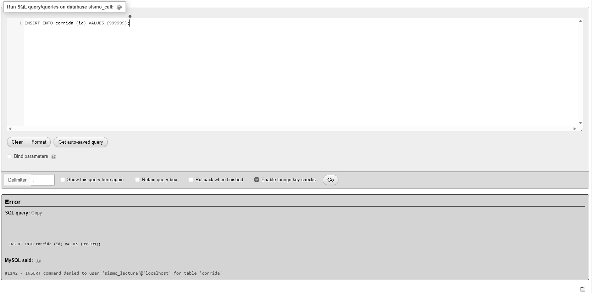

*Figura 7. Muestra que MySQL rechaza una escritura hecha con la cuenta de solo lectura.*

**Datos personales.** El proyecto no maneja datos personales: trabaja con construcciones por su huella catastral y con estrato por barrio. Las sesiones con personas usuarias aún no existen; cuando existan, sus nombres y consentimientos se guardan fuera del repositorio ([protocolo](docs/usuarios/protocolo_sesiones.md)). No definimos una política de retención: los snapshots de Bronze son inmutables y los registros de `logs/` se acumulan, un archivo por día, sin rotación ni borrado automático.

**Límite conocido.** El origen `localhost` de una cuenta no acota por sí solo quién puede conectarse: cualquier proceso local que tenga la contraseña puede hacerlo. La protección real es el mínimo privilegio más una contraseña aleatoria (D67).

## 15. Rendimiento y costos
Mediciones locales de una máquina, con su fecha ([docs/finanzas/recursos_medidos.csv](docs/finanzas/recursos_medidos.csv)):

| Qué | Valor | Fecha |
|---|---|---|
| Pipeline completo | 2,9 s y 148 MB de pico (mediana de 3 repeticiones en un clon nuevo) | 2026-11-16 |
| Latencia de la API sobre SQLite, mediana por ruta | de 3,6 a 13,9 ms | 2026-11-14 |
| Carga a MySQL de 5.622 filas, fila a fila frente a lotes de 2.000 | 2,415 s frente a 0,715 s | 2026-11-14 |
| Memoria de la API y el panel en reposo | unos 160 MiB | 2026-11-15 |
| Memoria de Airflow en reposo (siete contenedores: worker, triggerer, apiserver, dag-processor, scheduler, Postgres y Redis) | 1.970 MiB | 2026-11-14 |
| Memoria de phpMyAdmin en reposo | 33 MiB | 2026-11-15 |

Con 8 GB de RAM no conviene encender todo a la vez; esa configuración no está probada y la guía de instalación propone trabajar por tramos.

**Optimizaciones aplicadas** (verificadas en el código):
- La carga a MySQL va por lotes de 2.000 filas (`almacenamiento.lote` de `config/config.yaml`, con `executemany`) dentro de una sola transacción; fue 3,4 veces más rápida que fila a fila ([EV-030](docs/evidencias/almacenamiento/EV-030_benchmark_lotes.csv)).
- El esquema de MySQL define 8 índices secundarios (por ejemplo `ix_construccion_estrato` e `ix_construccion_severo`) en `src/load/sql/esquema_mysql.sql`.
- El panel guarda 300 s las respuestas correctas de la API (`ttl_cache_s`) y no guarda los fallos.
- La API pagina `/construcciones` (50 por omisión, 200 como máximo) y abre cada conexión de solo lectura por solicitud.
- Con Bronze presente, `--stage extract` no vuelve a descargar: verifica los sha256.

**Escalado.** Todo se midió con 5.146 construcciones. No medimos más datos, más personas usuarias a la vez ni otro motor de base de datos, y no prometemos cómo escala. Lo único medido que apunta a un límite es el consumo en reposo: unos 160 MiB para la API y el panel y 1.970 MiB para Airflow.

**Costos en la nube: no aplican.** Todo corre en una máquina local, así que no hay precios que medir. La estructura de costos, con las fórmulas y los precios como parámetros vacíos, está en [docs/finanzas/estructura_costos.md](docs/finanzas/estructura_costos.md); no inventamos ninguna cifra monetaria.

## 16. Decisiones de arquitectura
Las decisiones, con sus alternativas, su razón y su riesgo, están en [docs/DECISIONES.md](docs/DECISIONES.md) (D1 a D106). Las que más condicionan el diseño:

| Decisión | Qué decidimos | Por qué |
|---|---|---|
| D1 a D3 | escala construcción a barrio; la capa satelital como fuente principal; el estrato por barrio en CSV | alineada con el planteamiento del problema y con una unidad de análisis suficiente |
| D4 | la llave es el código catastral y no un nombre de barrio (la decisión original la modificó la verificación de las fuentes) | los nombres no cruzan; los códigos sí y se pueden validar |
| D6 | Bronze guarda respuestas crudas con manifiesto y no se sobrescribe | trazabilidad e idempotencia |
| D7 | el umbral de «severo» se define tras explorar Bronze | no conocíamos el dominio de antemano |
| D8 | USGS solo como contexto | no trae llave hacia un barrio |
| D10 | salida en CSV y en SQLite | recalcular los indicadores con SQL |
| D20 | el panel consume la API y no lee la base | un solo punto de acceso a los datos |
| D46 | dos bases y mínimo privilegio, sin usuarios con origen `%` | proteger los datos y poder verificar sin riesgo |
| D56 | pandas fijado en 3.0.6 | reproducir la línea base |
| D59 | cada tarea del DAG compara su salida con lo versionado | demostrar que Airflow no altera los resultados |
| D60, D65 y D67 | cuenta de MySQL propia para Docker, con origen `localhost` y sus límites declarados | permisos mínimos y honestidad sobre lo que protegen |
| D81 | dependencias exactas y Python 3.13 | reproducibilidad |
| D91 | phpMyAdmin local, solo para leer y con cuenta propia | ver las tablas sin poder cambiarlas |
| D97 y D105 | criterio de texto de lo que viaja en el zip; el README se escribe a mano | que lo que afirmamos lo vigile una prueba |
| D106 | el documento de arquitectura y sus registros de decisión viven en `docs/arquitectura/`; D21 y D5 quedan marcadas como modificadas | enlazar cada decisión con su origen sin duplicarla y no reescribir lo registrado |

El documento de arquitectura del sistema, con 14 registros de decisión (ADR) y diagramas en texto, está en [docs/arquitectura/arquitectura_del_sistema.md](docs/arquitectura/arquitectura_del_sistema.md) y [docs/arquitectura/adr/](docs/arquitectura/adr/). Está en Borrador hasta que se revise la documentación.

## 17. Contribución y estándares
Esta sección describe cómo trabajamos hoy; no hay un flujo de solicitudes de cambio porque no hay un repositorio publicado.

- **Ramas y commits:** el trabajo vive en la rama `desarrollo`; la rama `master` conserva un punto anterior y no se ha vuelto a integrar. No hay rama `main`. Cada commit es pequeño, va en español y nombra el componente que cambia.
- **Pruebas primero:** una regla, una prueba. Las reglas de documentos también se prueban (cifras, enlaces, términos prohibidos) y cada prueba nueva trae su caso negativo.
- **Antes de commitear:** correr las pruebas afectadas y `python scripts\escanear_secretos.py`.
- **Archivos:** UTF-8 y saltos de línea LF (`.gitattributes` fija los bytes de `data/`); rutas con `pathlib`; versiones exactas en `requirements.txt`.
- **Documentos:** los de análisis y de evidencias declaran qué afirman y qué no demuestran. Una cifra que se repite en varios lugares se vigila en todos.
- **Decisiones y evidencias:** cada decisión nueva se numera de forma consecutiva en `docs/DECISIONES.md`; cada evidencia se registra con su sha256 en el manifiesto y el estado de cada ítem del checklist se valida con `python scripts\validar_checklist.py`.
- **Secretos:** nunca en el repositorio, en notebooks, en registros ni en el zip.

**Lista de revisión para un cambio en el ETL**, derivada de lo que el repositorio ya exige:
1. Las salidas de la línea base no cambian, o el cambio se justifica y se registra: `tests/test_pipeline_reproducible.py` compara los nueve archivos y, si cambian, hay una decisión que lo explica (como D56).
2. Los umbrales de `config/config.yaml` siguen valiendo y `quality_report.json` dice `pasa`.
3. Toda regla de Silver nueva o cambiada está en `docs/silver/reglas_silver.md` con su hallazgo.
4. La decisión está registrada en `docs/DECISIONES.md` con el número siguiente.
5. Hay una prueba con su caso negativo, la suite pasa y las cifras repetidas en los documentos se actualizan (las pruebas fallan si no).
6. `python scripts\escanear_secretos.py` termina en `hallazgos: 0`.
7. Si hay una evidencia nueva, se registra con su sha256 en el manifiesto y `python scripts\validar_checklist.py --todos` pasa.

**No hay linter ni formateador configurados** (ni ruff, ni black, ni pre-commit). Las convenciones anteriores se cumplen por costumbre y por las pruebas.

## 18. Estado y hoja de ruta
| Componente | Estado |
|---|---|
| Pipeline Bronze, Silver y Gold | hecho y verificado, con las salidas versionadas |
| API de solo lectura y panel | hechos; el panel no está desplegado |
| Carga a MySQL y phpMyAdmin | hechos y verificados en vivo en una máquina |
| Airflow | hecho; la última prueba completa desde un zip nuevo es del 2026-11-16 |
| Sesiones con personas usuarias | material preparado (protocolo, guion, consentimiento, análisis probado con datos sintéticos rotulados); **aún sin sesiones reales** |
| Documento de arquitectura completo y registros de decisión por separado | escritos en Borrador, pendientes de revisión |
| Guion y grabación de la demostración | por hacer |
| Publicación del repositorio | por hacer |

La línea «aún sin sesiones reales» se actualiza cuando existan registros reales en `docs/usuarios/sesiones_reales/`; una prueba falla si ese directorio tiene registros reales y esta línea sigue diciendo lo contrario.

**Trabajo futuro del análisis:** incorporar la amenaza sísmica oficial (hoy no cubierta); ampliar la cobertura a la Comuna 2 y a las demás comunas ausentes; comparar el proxy satelital con las inspecciones ATC-20 de la Alcaldía; repetir el análisis con un estrato actualizado, porque el de 2015 puede estar desfasado.

## 19. Contacto y responsables
Estas son las personas responsables del proyecto. El reparto es un acuerdo del equipo de aquí en adelante; no describe quién hizo cada parte hasta hoy.

| Persona | Responsabilidad |
|---|---|
| Daniel Alexander Brand García | Orquestador y responsable general del proyecto: arquitectura, pipeline, calidad y seguridad |
| Diego Fernando Gordillo Londoño | Responsable del protocolo y del análisis de las sesiones con personas usuarias |
| Jhoan Sebastián Castellanos Mayor | Responsable de la revisión y el mantenimiento de la documentación, y del guion y la grabación de la demostración |

A quién acudir según el tema:

| Tema | Persona |
|---|---|
| Preguntas generales y técnicas: arquitectura, pipeline, calidad y seguridad | Daniel Alexander Brand García |
| Sesiones con personas usuarias: protocolo y análisis | Diego Fernando Gordillo Londoño |
| Documentación y demostración | Jhoan Sebastián Castellanos Mayor |

El repositorio aún no está publicado, así que todavía no hay un canal de contacto público. Cuando se publique, esta sección enlazará a sus issues. Las decisiones del proyecto se registran en [docs/DECISIONES.md](docs/DECISIONES.md).

## 20. Licencia y créditos
- **Código:** licencia MIT, en [LICENSE](LICENSE), a nombre de las tres personas del proyecto. Cubre el código (`src/`, `scripts/`, `tests/`, `dags/`, `orquestacion/`, `servicios/` y los notebooks) y la documentación propia.
- **Datos:** la licencia MIT no cubre los datos de `data/` ni las muestras de `docs/bronze/muestras/`, que conservan los términos de su fuente. Lo que declara cada publicador, sin conclusiones jurídicas, está en [docs/bronze/atribucion_y_terminos_de_datos.md](docs/bronze/atribucion_y_terminos_de_datos.md). Resumen: la capa satelital es del Fondo Adaptación (CC BY 4.0 según el catálogo de datos.gov.co); el estrato de 2015 es del DAPM Cali y figura con dos licencias distintas, por lo que lo tratamos con la condición más restrictiva; los polígonos de barrios son del IDESC y el DAPM Cali y los datos del evento son de USGS, y ninguno declara licencia en lo que verificamos.
- **Librerías:** cada una conserva su propia licencia. El compose de Airflow conserva su aviso de la licencia Apache 2.0.

Orquestación: el DAG y el compose de Airflow siguen el artículo de Juan Manuel Núñez Velasco, «Apache Airflow en Windows con WSL2 y Docker: tutorial paso a paso para orquestar un pipeline ETL 2026», con las diferencias documentadas en [docs/orquestacion/diferencias_con_la_guia.md](docs/orquestacion/diferencias_con_la_guia.md).

Todo el contenido generado con ayuda de IA en este proyecto está declarado en [DECLARACION_USO_IA.md](DECLARACION_USO_IA.md).
