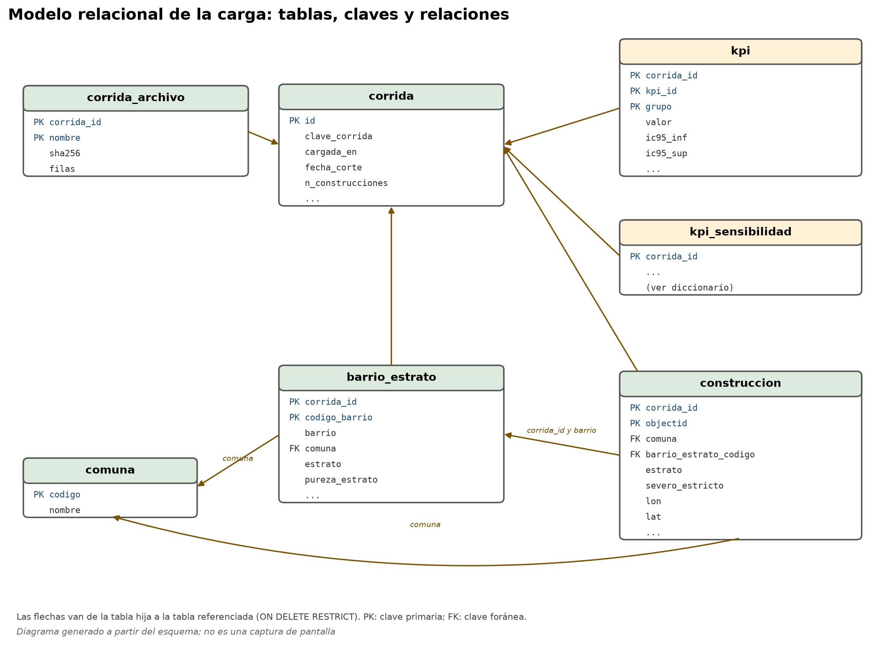

# Modelo de datos relacional

Este documento se genera con `scripts/make_modelo_datos.py` a partir de `src/load/sql/esquema_mysql.sql`; no se edita a mano. El mismo modelo existe para SQLite en `src/load/sql/esquema_sqlite.sql` y una prueba comprueba que ambos archivos declaren las mismas tablas y columnas, en el mismo orden.

## Cómo se organiza

- Una **corrida** es una carga completa del estrato por barrio, las construcciones de Gold y los indicadores. Cada fila de las tablas de datos lleva el identificador de su corrida, de modo que la historia es la suma de corridas y comparar dos cargas es una consulta.
- `comuna` es la única tabla sin `corrida_id`: reúne los códigos de comuna presentes en el CSV de estrato 2015 y en las construcciones; los códigos no cambian entre corridas y por eso se cargan una sola vez.
- Todas las claves foráneas usan `ON DELETE RESTRICT`: no se puede borrar una corrida que tenga datos ni una comuna que alguien use.
- Las 4 construcciones cuyo código de barrio no está en el CSV de estrato 2015 se cargan con `barrio_estrato_codigo` nulo; no se descarta ninguna ni se inventa un barrio.

## Relaciones

| Tabla | Columnas | Referencia | Columnas referenciadas |
|---|---|---|---|
| `corrida_archivo` | `corrida_id` | `corrida` | `id` |
| `barrio_estrato` | `corrida_id` | `corrida` | `id` |
| `barrio_estrato` | `comuna` | `comuna` | `codigo` |
| `construccion` | `corrida_id` | `corrida` | `id` |
| `construccion` | `corrida_id, barrio_estrato_codigo` | `barrio_estrato` | `corrida_id, codigo_barrio` |
| `construccion` | `comuna` | `comuna` | `codigo` |
| `kpi` | `corrida_id` | `corrida` | `id` |
| `kpi_sensibilidad` | `corrida_id` | `corrida` | `id` |

## Tablas

### `corrida`

Una fila por carga con datos distintos.

Clave primaria: `id`.

| Columna | Tipo | Nulo | Descripción |
|---|---|---|---|
| `id` | `BIGINT UNSIGNED` | no | identificador de la corrida |
| `clave_corrida` | `CHAR(64)` | no | sha256 de las huellas de los archivos de entrada ordenadas mas la version del esquema |
| `cargada_en` | `DATETIME(6)` | no | momento de la carga en UTC |
| `commit_codigo` | `VARCHAR(40)` | no | commit de git del codigo que cargo (desconocido si no hay git) |
| `fecha_corte` | `DATE` | no | fecha de edicion de la capa de origen (config.yaml) |
| `version_esquema` | `SMALLINT UNSIGNED` | no | version de este esquema |
| `n_barrios` | `INT UNSIGNED` | no | filas cargadas en barrio_estrato |
| `n_construcciones` | `INT UNSIGNED` | no | filas cargadas en construccion |
| `n_kpis` | `INT UNSIGNED` | no | filas cargadas en kpi |
| `n_kpis_sensibilidad` | `INT UNSIGNED` | no | filas cargadas en kpi_sensibilidad |
| `cobertura_llave` | `DECIMAL(7,6)` | no | cobertura de la llave (quality_report.json) |
| `cobertura_estrato_valido` | `DECIMAL(7,6)` | no | cobertura de estrato valido (quality_report.json) |
| `pct_nombre_validado` | `DECIMAL(7,6)` | no | proporcion de nombres validados (quality_report.json) |
| `llave_confianza` | `VARCHAR(10)` | no | confianza de la llave (quality_report.json) |

Índices: `uq_corrida_clave` (clave_corrida, único).

Restricciones de validación:

- `ck_corrida_coberturas`: `cobertura_llave BETWEEN 0 AND 1 AND cobertura_estrato_valido BETWEEN 0 AND 1 AND pct_nombre_validado BETWEEN 0 AND 1`

### `corrida_archivo`

Archivos de entrada de cada corrida con su huella.

Clave primaria: `corrida_id, nombre`.

| Columna | Tipo | Nulo | Descripción |
|---|---|---|---|
| `corrida_id` | `BIGINT UNSIGNED` | no | corrida a la que pertenece |
| `nombre` | `VARCHAR(120)` | no | ruta relativa del archivo de entrada |
| `sha256` | `CHAR(64)` | no | huella del archivo |
| `filas` | `INT UNSIGNED` | sí | filas de datos del archivo (nulo si no es tabular) |

### `comuna`

Comunas presentes en el CSV de estrato y en las construcciones.

Clave primaria: `codigo`.

| Columna | Tipo | Nulo | Descripción |
|---|---|---|---|
| `codigo` | `CHAR(2)` | no | codigo de la comuna con dos digitos |
| `nombre` | `VARCHAR(20)` | no | nombre derivado del codigo (Comuna N) |

### `barrio_estrato`

Estrato por barrio de 2015 (incluye barrios sin construcciones).

Clave primaria: `corrida_id, codigo_barrio`.

| Columna | Tipo | Nulo | Descripción |
|---|---|---|---|
| `corrida_id` | `BIGINT UNSIGNED` | no | corrida a la que pertenece |
| `codigo_barrio` | `VARCHAR(6)` | no | llave comuna por 100 mas barrio |
| `barrio` | `VARCHAR(64)` | no | nombre del barrio en el CSV de estrato 2015 |
| `comuna` | `CHAR(2)` | no | comuna derivada del codigo del barrio |
| `lados_e1` | `INT UNSIGNED` | no | lados de manzana de estrato 1 |
| `lados_e2` | `INT UNSIGNED` | no | lados de manzana de estrato 2 |
| `lados_e3` | `INT UNSIGNED` | no | lados de manzana de estrato 3 |
| `lados_e4` | `INT UNSIGNED` | no | lados de manzana de estrato 4 |
| `lados_e5` | `INT UNSIGNED` | no | lados de manzana de estrato 5 |
| `lados_e6` | `INT UNSIGNED` | no | lados de manzana de estrato 6 |
| `sin_vivienda` | `INT UNSIGNED` | no | lados de manzana sin vivienda |
| `lados_total` | `INT UNSIGNED` | no | suma de los lados de manzana por estrato |
| `estrato_moda_original` | `VARCHAR(2)` | no | estrato moda tal como viene en el CSV |
| `estrato` | `TINYINT UNSIGNED` | sí | estrato moda validado de 1 a 6 (nulo si no aplica) |
| `pureza_estrato` | `DECIMAL(7,6)` | sí | maximo de lados por estrato sobre su suma |

Índices: `ix_barrio_estrato_comuna` (comuna).

Restricciones de validación:

- `ck_barrio_estrato_estrato`: `estrato IS NULL OR estrato BETWEEN 1 AND 6`
- `ck_barrio_estrato_pureza`: `pureza_estrato IS NULL OR pureza_estrato BETWEEN 0 AND 1`

### `construccion`

Construcciones evaluadas por satelite (gold_final).

Clave primaria: `corrida_id, objectid`.

| Columna | Tipo | Nulo | Descripción |
|---|---|---|---|
| `corrida_id` | `BIGINT UNSIGNED` | no | corrida a la que pertenece |
| `objectid` | `INT UNSIGNED` | no | identificador de la construccion en la capa |
| `comuna` | `CHAR(2)` | sí | codigo catastral de la comuna (nulo si venia en blanco) |
| `barrio` | `CHAR(2)` | sí | codigo catastral del barrio dentro de la comuna |
| `codigo_barrio` | `VARCHAR(6)` | sí | llave comuna por 100 mas barrio tal como esta en Gold |
| `nombre_barrio_csv` | `VARCHAR(64)` | sí | nombre del barrio en el CSV de estrato (nulo si no cruza) |
| `cruza_llave` | `TINYINT(1)` | no | la llave existe en el CSV de estrato |
| `barrio_estrato_codigo` | `VARCHAR(6)` | sí | enlace a barrio_estrato (nulo si la construccion no cruza) |
| `estrato` | `TINYINT UNSIGNED` | sí | estrato moda del barrio |
| `pureza_estrato` | `DECIMAL(7,6)` | sí | pureza del estrato del barrio |
| `n_con_datos_estrato` | `INT UNSIGNED` | sí | construcciones con datos del estrato |
| `n_severos_estrato` | `INT UNSIGNED` | sí | severos del estrato |
| `muestra_baja` | `TINYINT(1)` | sí | menos de 30 severos en el estrato |
| `npisos` | `SMALLINT UNSIGNED` | sí | numero de pisos |
| `npisos_cero` | `TINYINT(1)` | sí | bandera de cero pisos |
| `indice_escombros` | `DECIMAL(18,12)` | sí | indice continuo de cambio de textura (nulo si no hay datos satelitales) |
| `estado_estructural` | `VARCHAR(48)` | no | etiqueta original de la capa |
| `clase_dano` | `VARCHAR(16)` | no | clase estable derivada de la etiqueta |
| `sin_datos` | `TINYINT(1)` | no | sin datos satelitales |
| `severo_estricto` | `TINYINT(1)` | sí | cambio satelital severo (severo estricto, proxy de dano) - nulo si no hay datos |
| `dano_visible` | `TINYINT(1)` | sí | sensibilidad: escombros o techo - nulo si no hay datos |
| `geom_duplicada` | `TINYINT(1)` | no | comparte geometria con otra construccion |
| `lon` | `DECIMAL(10,7)` | no | longitud del centroide en grados |
| `lat` | `DECIMAL(10,7)` | no | latitud del centroide en grados |
| `codigo_poligono` | `VARCHAR(6)` | no | codigo del poligono donde cae el centroide |
| `nombre_poligono` | `VARCHAR(80)` | no | nombre del poligono |
| `coincide_poligono` | `TINYINT(1)` | sí | el codigo del poligono coincide con el codigo del barrio |
| `nombre_validado` | `TINYINT(1)` | sí | el nombre del CSV coincide con el del poligono dominante |

Índices: `ix_construccion_barrio` (corrida_id, barrio_estrato_codigo); `ix_construccion_comuna` (comuna); `ix_construccion_estrato` (corrida_id, estrato); `ix_construccion_severo` (corrida_id, severo_estricto); `ix_construccion_nombre_validado` (corrida_id, nombre_validado).

Restricciones de validación:

- `ck_construccion_estrato`: `estrato IS NULL OR estrato BETWEEN 1 AND 6`
- `ck_construccion_pureza`: `pureza_estrato IS NULL OR pureza_estrato BETWEEN 0 AND 1`
- `ck_construccion_lon`: `lon BETWEEN -77 AND -76`
- `ck_construccion_lat`: `lat BETWEEN 3 AND 4`
- `ck_construccion_banderas`: `cruza_llave IN (0, 1) AND sin_datos IN (0, 1) AND geom_duplicada IN (0, 1)`
- `ck_construccion_enlace`: `(cruza_llave = 1 AND barrio_estrato_codigo IS NOT NULL) OR (cruza_llave = 0 AND barrio_estrato_codigo IS NULL)`
- `ck_construccion_severo`: `(sin_datos = 1 AND severo_estricto IS NULL AND dano_visible IS NULL) OR (sin_datos = 0 AND severo_estricto IN (0, 1) AND dano_visible IN (0, 1))`

### `kpi`

Indicadores de Gold (kpis_gold).

Clave primaria: `corrida_id, kpi_id, grupo`.

| Columna | Tipo | Nulo | Descripción |
|---|---|---|---|
| `corrida_id` | `BIGINT UNSIGNED` | no | corrida a la que pertenece |
| `orden` | `SMALLINT UNSIGNED` | no | posicion de la fila en kpis_gold.csv |
| `kpi_id` | `VARCHAR(4)` | no | identificador del indicador (K1 a K6) |
| `nombre` | `VARCHAR(80)` | no | nombre del indicador |
| `valor` | `DOUBLE` | no | valor del indicador (tasa, razon o proporcion) |
| `numerador` | `DOUBLE` | sí | numerador |
| `denominador` | `DOUBLE` | sí | denominador (construcciones con datos satelitales) |
| `grupo` | `VARCHAR(48)` | no | grupo o corte del indicador |
| `fecha_corte` | `DATE` | no | fecha de corte de la capa |
| `fuente` | `VARCHAR(255)` | no | fuente declarada del calculo |
| `ic95_inf` | `DOUBLE` | sí | limite inferior del intervalo al 95 por ciento |
| `ic95_sup` | `DOUBLE` | sí | limite superior del intervalo al 95 por ciento |
| `n_sin_datos` | `DOUBLE` | sí | construcciones sin datos satelitales |
| `pct_sin_datos` | `DOUBLE` | sí | proporcion sin datos satelitales |
| `muestra_baja` | `TINYINT(1)` | no | menos de 30 severos |
| `cota_inf` | `DOUBLE` | sí | cota inferior por sin datos |
| `cota_sup` | `DOUBLE` | sí | cota superior por sin datos |
| `nota` | `VARCHAR(512)` | sí | nota del indicador |

Índices: `ix_kpi_orden` (corrida_id, orden).

Restricciones de validación:

- `ck_kpi_valor`: `grupo LIKE 'razon%' OR valor BETWEEN 0 AND 1`
- `ck_kpi_intervalo`: `grupo LIKE 'razon%' OR grupo LIKE 'diferencia%' OR ((ic95_inf IS NULL OR ic95_inf BETWEEN 0 AND 1) AND (ic95_sup IS NULL OR ic95_sup BETWEEN 0 AND 1))`

### `kpi_sensibilidad`

Sensibilidades de los indicadores (kpis_sensibilidad).

Clave primaria: `corrida_id, escenario, kpi_id, grupo`.

| Columna | Tipo | Nulo | Descripción |
|---|---|---|---|
| `corrida_id` | `BIGINT UNSIGNED` | no | corrida a la que pertenece |
| `orden` | `SMALLINT UNSIGNED` | no | posicion de la fila en kpis_sensibilidad.csv |
| `escenario` | `VARCHAR(4)` | no | escenario de sensibilidad (S0 a S5) |
| `kpi_id` | `VARCHAR(4)` | no | indicador |
| `grupo` | `VARCHAR(48)` | no | grupo o corte |
| `k` | `INT UNSIGNED` | sí | severos |
| `n` | `INT UNSIGNED` | sí | construcciones con datos |
| `tasa` | `DOUBLE` | sí | k sobre n, razon o diferencia segun el grupo |
| `ic95_inf` | `DOUBLE` | sí | limite inferior del intervalo al 95 por ciento |
| `ic95_sup` | `DOUBLE` | sí | limite superior del intervalo al 95 por ciento |
| `nota` | `VARCHAR(512)` | no | descripcion del escenario |

Índices: `ix_kpi_sensibilidad_orden` (corrida_id, orden).

Restricciones de validación:

- `ck_kpi_sensibilidad_tasa`: `tasa IS NULL OR grupo LIKE 'razon%' OR grupo LIKE 'diferencia%' OR tasa BETWEEN 0 AND 1`
- `ck_kpi_sensibilidad_intervalo`: `grupo LIKE 'razon%' OR grupo LIKE 'diferencia%' OR ((ic95_inf IS NULL OR ic95_inf BETWEEN 0 AND 1) AND (ic95_sup IS NULL OR ic95_sup BETWEEN 0 AND 1))`
