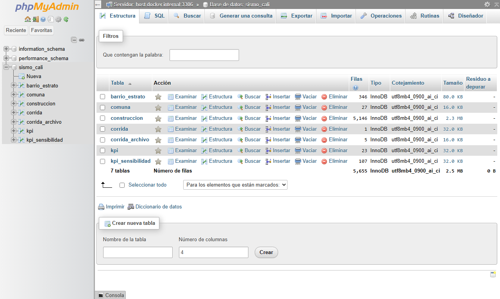
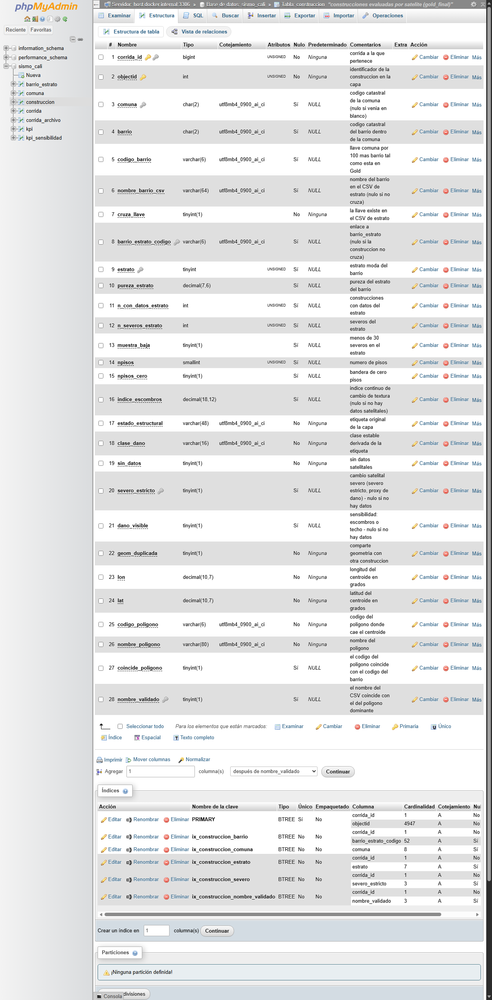
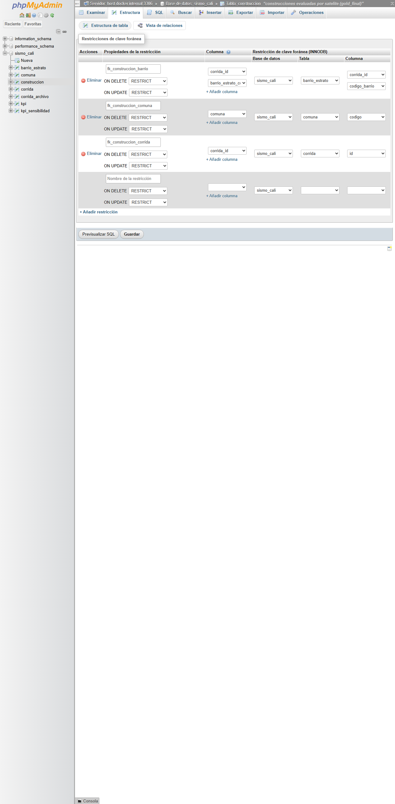
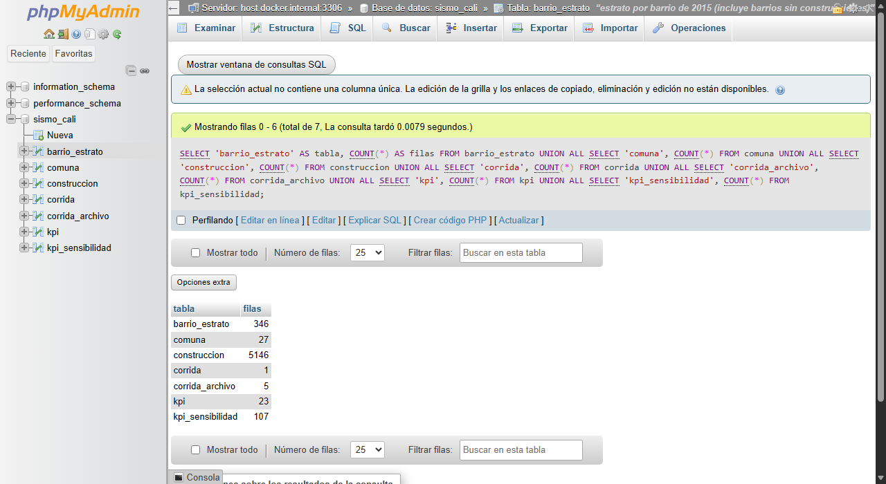
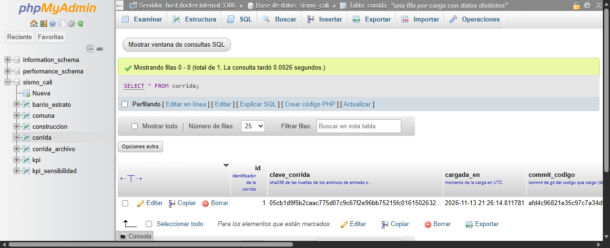
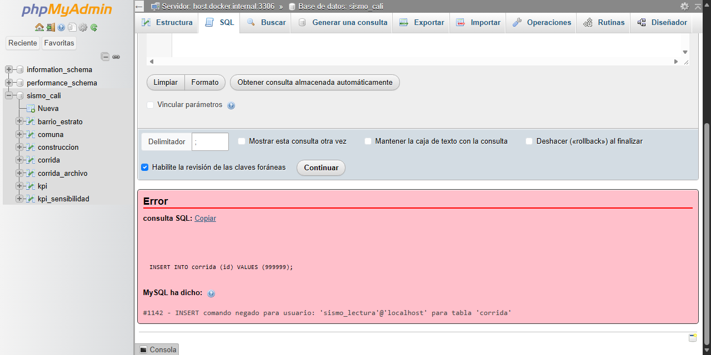
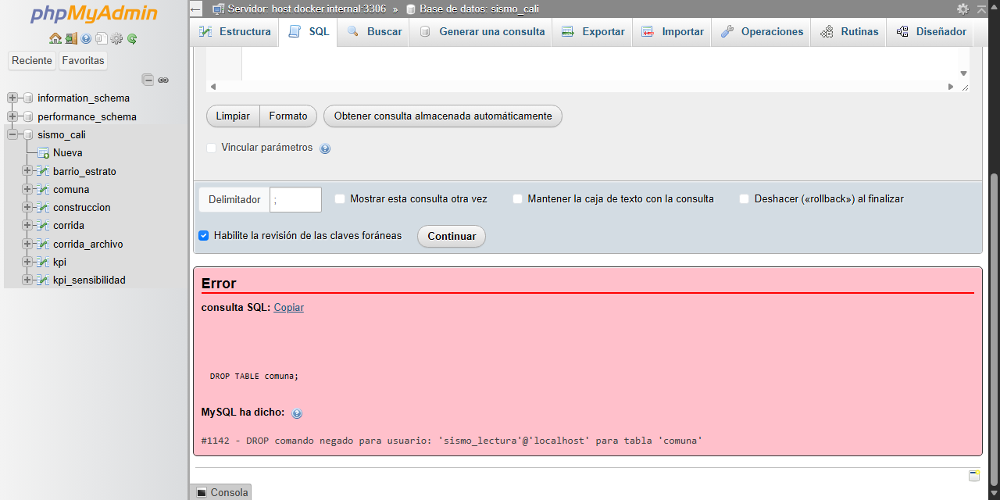

# phpMyAdmin de solo lectura

**Componente:** Servicios locales · **Compose:** [servicios/phpmyadmin/docker-compose.yaml](../../servicios/phpmyadmin/docker-compose.yaml) · **Cuenta:** `sismo_lectura` · **Decisión:** [D91](../DECISIONES.md) · **Ítems del checklist:** 4.1 y 4.2

phpMyAdmin es una página web para mirar una base de MySQL. La agregamos porque el equipo quería ver las siete tablas de `sismo_cali`, sus claves foráneas y los conteos sin escribir consultas a mano, y
porque quien revise el proyecto puede comprobar así que lo que carga el DAG de Airflow quedó en la base. La dejamos **solo para mirar**: un lugar donde se puede escribir con el ratón es un lugar donde alguien puede
borrar la base por accidente.

## 1. Por qué solo lectura
La garantía no está en phpMyAdmin sino en MySQL: la cuenta `sismo_lectura` tiene únicamente el privilegio `SELECT` sobre `sismo_cali` (sin `INSERT`, `UPDATE`, `DELETE`, `CREATE`, `DROP`, `ALTER`, `INDEX` ni `REFERENCES`,
sin `GRANT OPTION`, sin privilegios globales y sin acceso a `sismo_cali_prueba`). Si alguien teclea un `INSERT` o un `DROP` en la pestaña SQL, el servidor lo rechaza por privilegios. Lo comprobamos en vivo
([EV-085](../evidencias/servicios/EV-085_phpmyadmin_en_vivo.txt)). El compose, además, no guarda ni usuario ni contraseña, publica el puerto solo en `127.0.0.1` y no admite otros servidores (decisión D91).

## 2. Cómo arrancarlo y pararlo
Hace falta Docker Desktop encendido y la cuenta creada una sola vez, con la contraseña de `root` tecleada por quien la conoce:
```powershell
.\.venv\Scripts\python.exe scripts\mysql\configurar_mysql.py --usuario-lectura
```
Después, desde la raíz del proyecto:
```powershell
docker compose -f servicios\phpmyadmin\docker-compose.yaml up -d      # arranca; la página queda en http://127.0.0.1:8081
docker compose -f servicios\phpmyadmin\docker-compose.yaml ps         # estado
docker compose -f servicios\phpmyadmin\docker-compose.yaml down       # para y elimina el contenedor
```
Memoria: el contenedor ocupó unos 33 MiB en reposo ([recursos_medidos.csv](../finanzas/recursos_medidos.csv)). Si el 8081 está ocupado: `$env:PMA_PUERTO = "8091"` antes de `up`. La imagen se descarga la primera vez (unos 820 MB de disco). No se reinicia sola: tras reiniciar el equipo hay que volver a ejecutar `up -d`.

## 3. Cómo entrar
Abrir `http://127.0.0.1:8081`, escribir como usuario `sismo_lectura` y como contraseña el valor de la variable `MYSQL_LECTURA_PASSWORD` del archivo `.env` del proyecto (que Git ignora) y pulsar «Continuar».
El servidor ya viene fijado (el MySQL de este equipo, por `host.docker.internal`), así que el formulario no pide servidor.

## 4. Qué mirar
Las capturas son «capturas automatizadas del navegador» de la verificación en vivo ([EV-085](../evidencias/servicios/EV-085_phpmyadmin_en_vivo.txt)); no las tomó una persona. En ellas no aparece ninguna contraseña.

1. **Las siete tablas de `sismo_cali`.** Al entrar, en la base `sismo_cali` se ven `barrio_estrato`, `comuna`, `construccion`, `corrida`, `corrida_archivo`, `kpi` y `kpi_sensibilidad` con sus filas (estimadas por InnoDB).
   
2. **La estructura de `construccion`.** Sus 28 columnas con tipo, comentario y los índices; cada columna trae el comentario que escribimos en el esquema (`src/load/sql/esquema_mysql.sql`).
   
3. **Las claves foráneas.** En «Estructura → Vista de relaciones» de `construccion` aparecen `fk_construccion_barrio`, `fk_construccion_comuna` y `fk_construccion_corrida`, las tres con `RESTRICT` (no se puede borrar una corrida que tenga datos). Usamos esta vista y no el Diseñador gráfico, porque este necesita el almacenamiento de configuración que no instalamos.
   
4. **Los conteos.** En la pestaña SQL, una consulta de lectura con un `COUNT(*)` por tabla dio `construccion` 5.146, `kpi` 23 y `kpi_sensibilidad` 107, iguales a las filas de `gold_final.csv`, `kpis_gold.csv` y `kpis_sensibilidad.csv`; `corrida` tiene 1 fila (una sola carga).
   
5. **La tabla `corrida`.** Una fila por carga con datos distintos: su identificador, la clave (sha256 de las huellas de los archivos de entrada), el momento de la carga y el commit del código.
   
6. **Lo que no se puede hacer.** Un `INSERT` o un `DROP` en la pestaña SQL recibe de MySQL el error #1142 («comando negado para el usuario `sismo_lectura`»); lo mismo con `UPDATE` y `DELETE`. Los conteos no cambiaron.
   
   

Esto muestra que lo cargado en MySQL coincide con lo versionado y que la cuenta no puede cambiarlo; no demuestra que los datos sean correctos, solo que la carga concilia con Gold.

## 5. Imagen y versión
| Dato | Valor | Cómo se obtuvo |
|---|---|---|
| Imagen | `phpmyadmin:5.2.3` fijada por su resumen `sha256:e4b3eb5305cd42d21512bb55def2bab52625d56df927ad4ee1864a9354c84d40` | `docker pull phpmyadmin:5.2.3` el 2026-11-14 |
| Versión de phpMyAdmin | 5.2.3, publicada el 2025-10-07 | `ChangeLog` dentro de la imagen |
| Fecha de la imagen | construida el 2026-11-05 | `docker image inspect` |
| Por qué esta | la última de la rama 5.2 (la 5.2.2 es de octubre de 2025); la versión del programa tiene más de dos semanas, aunque la etiqueta de Docker se reconstruyó el 2026-11-05 | Docker Hub y el `ChangeLog` |

## 6. Qué no hace
- No crea ni cambia usuarios, bases ni tablas, y no sirve para cargar datos (para eso están `scripts/cargar_mysql.py` y el DAG).
- No usa el almacenamiento de configuración de phpMyAdmin, por lo que el Diseñador gráfico puede no estar disponible; las relaciones se ven en la vista «Estructura → Vista de relaciones» de cada tabla.
- No está pensado para exponerse en una red ni en un servidor: solo escucha en `127.0.0.1` y la conexión no está cifrada porque no sale del equipo.
- No es una evaluación de seguridad de phpMyAdmin: usamos la imagen oficial sin cambios, con la configuración mínima.

## 7. Alcance y límites
- **Qué afirmamos:** con la cuenta `sismo_lectura` se ven las tablas de `sismo_cali` y MySQL rechaza una escritura, en una ejecución real en esta máquina (EV-085).
- **Qué NO demuestra:** que otra persona pueda entrar sin crear la cuenta (necesita la contraseña de `root` una vez), que la imagen sea segura para otros usos ni que funcione con otro origen de conexión distinto de `localhost` (Docker en Linux nativo).
