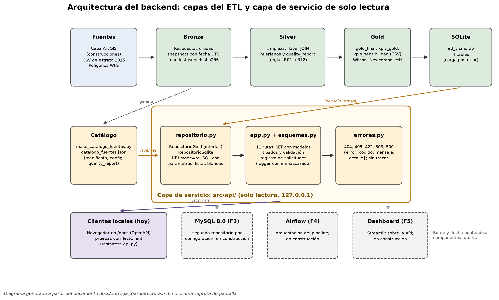

# Arquitectura del backend: API de solo lectura y servicios de datos

**Fecha:** 2026-11-12 · **Ítem del checklist:** 2.1 «Diseñamos e implementamos la arquitectura de Backend, APIs y servicios para el procesamiento de datos.» · **Alcance:** capas del ETL, capa de servicio (`src/api/`), contratos, errores, seguridad, observabilidad y límites. Lo que está en construcción se marca así.

**Etiquetas de evidencia:** [Evidencia en el repo: ruta] · [Fuente externa: URL y fecha de consulta] · [Criterio aplicado: descripción] · [Hipótesis de diseño: criterio y experimento, no ejecutado].

> **Alcance de los resultados.** Los datos que la API entrega son un **proxy satelital, no una evaluación estructural**: construcciones de 7 comunas de Cali (polígonos de afectación preliminar) con estrato de **2015**. No se generaliza a Cali. Nuestro indicador es el cambio satelital severo (severo estricto, proxy de daño).

## 1. Visión general (para quien empieza)
El proyecto es un ETL con capas: **Bronze** guarda lo descargado tal cual, **Silver** lo limpia y lo une, **Gold** calcula los indicadores. Los resultados del ETL se entregan como archivos. La capa de servicio agrega una **API**: un programa que responde preguntas por HTTP, como «dame los indicadores» o «dame las construcciones de la comuna 19». Cada pregunta se hace a un **endpoint** (una dirección, por ejemplo `/kpis`). Es de **solo lectura**: puede entregar los resultados, pero no puede cambiarlos ni crear nuevos, de modo que nadie puede dañar la línea base consultándola.



*Diagrama generado a partir del documento; no es una captura de pantalla.*

## 2. Módulos, responsabilidades, entradas y salidas
| módulo | responsabilidad | entradas | salidas |
|---|---|---|---|
| `src/extract/` | descarga paginada y snapshots de Bronze | URL de `config.yaml`, red | respuestas crudas y `manifest.jsonl` con sha256 |
| `src/transform/` | limpieza, llave, JOIN, Gold y KPI | Bronze | Silver, Gold y `quality_report.json` |
| `src/load/load_database.py` | carga posterior a SQLite | CSV de Silver y Gold | `data/gold/etl_sismo.db` |
| `src/api/repositorio.py` | acceso a datos detrás de la interfaz `RepositorioGold`; implementaciones `RepositorioSqlite` y `RepositorioRelacional` (última corrida del almacén relacional) | ruta de la base o conexión | filas (diccionarios) |
| `src/load/relacional.py`, `src/load/conexion.py` | carga relacional por lotes con historial a MySQL (o SQLite en pruebas) y conexiones | CSV de Silver y Gold | tablas relacionales (`docs/almacenamiento/modelo_datos.md`) |
| `src/api/app.py` | fábrica `crear_app`, rutas GET, validación y registro de solicitudes | parámetros de la solicitud | JSON tipado |
| `src/api/esquemas.py` | modelos de respuesta (pydantic) | filas | contratos del API |
| `src/api/errores.py` | manejadores de error y formato uniforme | excepciones | `{"error": {...}}` |
| `scripts/make_catalogo_fuentes.py` | catálogo de fuentes y metadatos | manifiesto, config, metadatos de Bronze, `quality_report.json`, `docs/gold/KPIs.md` | `catalogo_fuentes.json` y `.md` |
| `scripts/escanear_secretos.py` | búsqueda de secretos | árbol, historial, notebooks, logs, zip | hallazgos (archivo, línea, patrón) |

La API **no calcula estadística**: entrega lo que Gold ya contiene. Los únicos cálculos son conteos y sumas (`COUNT`, `SUM`) en `/composicion`, y agrupaciones de códigos en `/llave/revision`.

## 3. Flujo de datos
1. Bronze → Silver → Gold se ejecutan con `main.py` (no desde la API).
2. `load_database` copia Silver y Gold a `etl_sismo.db`.
3. Al llegar una solicitud, `app.py` valida los parámetros, abre **una conexión de solo lectura** (`repositorio.py`), consulta, cierra la conexión y devuelve JSON.
4. `/calidad` lee `quality_report.json`, `/fuentes` lee `catalogo_fuentes.json` y `/metadata` combina `config.yaml`, el manifiesto y Gold.

## 4. Contratos (resumen)
Todos los endpoints son `GET`. Los errores usan siempre el formato de la sección 6.

| endpoint | parámetros | respuesta |
|---|---|---|
| `/health` | — | estado, versión de la API, fecha de corte, base disponible y filas por tabla |
| `/metadata` | — | aviso, fechas de edición de la capa y de las imágenes, población analizada, alcance temporal, licencias y fuentes |
| `/fuentes` | — | catálogo de fuentes (extensión, ítem 2.2) |
| `/kpis` | `kpi_id` (K1 a K6), `grupo` | filas de `kpis_gold` tal como están |
| `/kpis/sensibilidad` | `escenario` (S0 a S5) | filas de `kpis_sensibilidad` |
| `/kpis/{kpi_id}` | — | todas las filas de un indicador (extensión) |
| `/comunas` | — | K6 por comuna |
| `/composicion` | — | construcciones con datos y severos por comuna y grupo de estrato (extensión) |
| `/construcciones` | `limit` (1 a 200, por defecto 50), `offset`, `comuna` (2 dígitos), `estrato` (1 a 6), `severo_estricto` | página ordenada por `objectid` con `total`, `limit`, `offset` e `items` |
| `/calidad` | — | coberturas y confianza de la llave |
| `/llave/revision` | — | códigos de barrio con nombre no validado |

`/kpis/sensibilidad` se declara **antes** de `/kpis/{kpi_id}`; si no, «sensibilidad» se leería como un identificador de indicador. Una prueba verifica el orden.

### Ejemplos reales de respuesta
Capturados en un clon temporal con el servicio en `127.0.0.1` y guardados en `docs/evidencias/api/respuestas_api/`. [Evidencia en el repo: `docs/evidencias/api/EV-016_respuestas_api.txt`]

`GET /health`
```json
{"estado":"ok","version_api":"1.0.0","fecha_corte":"2026-09-02","base_disponible":true,"filas_por_tabla":{"silver_integrated":5146,"gold_final":5146,"kpis_gold":23,"kpis_sensibilidad":107}}
```

`GET /comunas` (primer elemento)
```json
{"comuna":"03","n_con_datos":550.0,"severos":39.0,"tasa":0.070909090909,"ic95_inf":0.052302352954,"ic95_sup":0.095468417606,"n_sin_datos":61.0,"pct_sin_datos":0.099836333879,"muestra_baja":false}
```

`GET /composicion` (primeros elementos)
```json
[{"comuna":"03","grupo_estrato":"3-5","n_con_datos":550,"severos":39},{"comuna":"09","grupo_estrato":"3-5","n_con_datos":184,"severos":7}]
```

`GET /construcciones?limit=5` (encabezado y primer elemento; `total` = 5146)
```json
{"total":5146,"limit":5,"offset":0,"items":[{"objectid":1,"comuna":"19","barrio":"04","codigo_barrio":"1904","estrato":5.0,"sin_datos":false,"severo_estricto":false,"clase_dano":"sin_cambio","lon":-76.543059,"lat":3.4209026,"coincide_poligono":true,"nombre_validado":true}]}
```
(se omiten dos campos de texto para abreviar; la respuesta real los incluye).

`GET /calidad`
```json
{"cobertura_llave":{"num":5140,"den":5146,"pct":0.998834},"cobertura_estrato_valido":{"num":5138,"den":5146,"pct":0.998445},"pct_nombre_validado":{"global":{"num":4807,"den":5140,"pct":0.935214},"coincide_poligono_true":{"num":4391,"den":4703,"pct":0.933659},"coincide_poligono_false":{"num":416,"den":437,"pct":0.951945}},"llave_confianza":"alta"}
```

`GET /llave/revision` (primer elemento; `total_codigos` = 7)
```json
{"codigo_barrio":"1011","n_construcciones":55,"nombre_csv_2015":"Barrio Departamental","nombre_poligono_dominante":"Departamental","pct_coincide_poligono":1.0}
```

## 5. Configuración
Los parámetros de la API están en `config/config.yaml`, clave `api`: `version`, `host` (127.0.0.1), `puerto` (8000), `limite_defecto` (50), `limite_maximo` (200), `base_datos` (`data/gold/etl_sismo.db`), `catalogo_fuentes` y `aviso`. No hay secretos: la API no usa credenciales (ver `docs/seguridad/gestion_credenciales.md`).

## 6. Manejo de errores
Toda respuesta de error tiene la forma `{"error": {"codigo", "mensaje", "detalle"}}`.

| situación | estado | `codigo` |
|---|---|---|
| ruta o identificador inexistente (por ejemplo `/kpis/K99`) | 404 | `no_encontrado` |
| método distinto de GET (POST, PUT, DELETE, PATCH) | 405 | `metodo_no_permitido` |
| parámetro inválido (por ejemplo `limit=999`) | 422 | `parametros_invalidos` (con `detalle` por campo) |
| base, catálogo o informe no disponibles | 503 | `base_no_disponible` |
| error inesperado | 500 | `error_interno` (sin trazas ni rutas locales; la traza va solo al registro) |

Ejemplo real: `GET /kpis/K99` → `{"error":{"codigo":"no_encontrado","mensaje":"no existe el indicador K99","detalle":null}}`.

## 7. Idempotencia y determinismo
Las consultas no cambian estado: la misma solicitud devuelve la misma respuesta mientras Gold no cambie. La conexión es de solo lectura y una prueba compara los sha256 de `data/` y de la base antes y después de consultar todos los endpoints (`tests/test_api.py`, EV-015). El catálogo se genera sin fecha de ejecución, así que dos generaciones son idénticas.

## 8. Observabilidad
Cada solicitud se registra con `src/logger.py` (método, ruta, estado y duración en ms), en consola y en `logs/etl_AAAAMMDD.log`, con enmascarado de secretos. Ejemplo real: `GET /llave/revision -> 200 en 3.7 ms`. No se registran cuerpos ni parámetros sensibles.

<!-- latencias:inicio -->
### Rendimiento (medición local)
Latencia por ruta con el **servidor real** en `127.0.0.1` (no el cliente de pruebas): 50 solicitudes de medición tras 5 de calentamiento, en una sola máquina; el percentil 95 es por rango más cercano. Son mediciones locales y no representan un despliegue. [Evidencia en el repo: `docs/evidencias/api/EV-018_latencia_api.csv`]

| ruta | mediana (ms) | percentil 95 (ms) | máximo (ms) |
|---|---|---|---|
| `/health` | 5,2 | 6,5 | 6,7 |
| `/metadata` | 11,0 | 12,2 | 13,9 |
| `/fuentes` | 3,9 | 4,7 | 5,7 |
| `/kpis` | 3,2 | 4,3 | 4,8 |
| `/kpis/K1` | 4,2 | 5,9 | 6,2 |
| `/kpis/sensibilidad` | 6,3 | 7,9 | 8,2 |
| `/comunas` | 4,7 | 6,6 | 7,0 |
| `/composicion` | 7,0 | 8,1 | 10,6 |
| `/construcciones?limit=5` | 4,4 | 5,8 | 6,6 |
| `/calidad` | 7,5 | 9,9 | 10,1 |
| `/llave/revision` | 5,1 | 6,7 | 7,0 |
<!-- latencias:fin -->

## 9. Seguridad y amenazas
| amenaza | superficie | qué se bloquea y cómo | cómo se prueba |
|---|---|---|---|
| modificar datos | ninguna ruta de escritura; la conexión es `file:<ruta>?mode=ro` | el motor rechaza INSERT, UPDATE y DELETE | prueba de `INSERT` con `sqlite3.OperationalError`; solo rutas GET; 405 en los demás métodos |
| inyección SQL | `comuna`, `estrato`, `kpi_id`, `escenario`, `grupo` | parámetros validados con patrón y SQL siempre con parámetros; listas blancas para tablas y columnas | `test_la_inyeccion_en_comuna_y_estrato_se_rechaza` |
| exposición en red | el servicio no tiene autenticación | enlazado a `127.0.0.1` por defecto; sin CORS | revisión del comando de arranque y de `crear_app` |
| fuga de información en errores | respuestas 500 | sin trazas ni rutas locales | `test_un_error_interno_da_500_sin_trazas_ni_rutas` |
| agotar recursos | `/construcciones` | `limit` máximo 200 y `offset` acotado | `test_limites_de_paginacion_y_offset` |
| datos personales | ninguno en Gold | las columnas expuestas son una lista blanca sin identificadores de personas | revisión del esquema `Construccion` |
| secretos | ninguno usado | no hay credenciales en la API ni en el repositorio | escáner de secretos (EV-019) |

## 10. Modos de ejecución
- **Servicio local:** `.\.venv\Scripts\python.exe -m uvicorn src.api.app:app --host 127.0.0.1 --port 8000`; documentación automática en `http://127.0.0.1:8000/docs` y esquema en `/openapi.json`.
- **Pruebas:** `pytest -q` usa `fastapi.testclient.TestClient` sin abrir puertos ni red.
- **Otra base:** `crear_app(ruta_db)` acepta otra ruta (las pruebas la usan para simular una base ausente).

## 11. Límites del diseño
- Sin autenticación ni cifrado: está pensado para uso local (127.0.0.1). Un despliegue en red necesitaría otra decisión (autenticación y HTTPS).
- Los resultados de Gold son un proxy satelital; la API no los interpreta ni los valida.
- `/construcciones` no ofrece búsqueda de texto ni ordenamientos distintos de `objectid`.
- La base de SQLite es una copia de los CSV: si se regeneran, hay que volver a cargarla (`main.py --stage all`).
- Con el cliente de pruebas de Starlette hay un aviso que recomienda `httpx2`; no instalamos paquetes no aprobados (D33).

## 12. Alternativas descartadas
- **Servidor con `http.server`:** quedó como respaldo (decisión a de `decisiones_tecnicas.md`); sin OpenAPI.
- **ORM (SQLAlchemy):** más dependencias para consultas simples; descartado en D24.
- **CORS abierto o `0.0.0.0`:** innecesario y riesgoso sin autenticación (D29).
- **Calcular en la API:** duplicaría lógica de Gold y podría contradecirla; la API solo entrega.

## 13. Almacén relacional y componentes futuros
- **Carga a MySQL (Carga relacional):** implementada. `api.almacenamiento` en `config/config.yaml` elige `sqlite` (por defecto) o `mysql`; los endpoints no cambian y `/health` y `/metadata` informan el almacén activo. Se abre una conexión de solo lectura por solicitud y, si MySQL no responde, la API contesta 503 con el JSON uniforme. Ver `docs/almacenamiento/carga_y_verificacion.md`.
- **Orquestación con Airflow (Pruebas y orquestación):** implementada fuera de `src/`: el DAG `medallon_etl_sismo` ejecuta las cuatro etapas desde una copia de trabajo con el repositorio en solo lectura. Ver `docs/orquestacion/`.
- **Dashboard con Streamlit (Panel):** implementado en `src/panel/`; consume solo esta API por HTTP (solo GET) y nunca abre la base. Ver `docs/panel/arquitectura_panel.md`.

## Alcance y límites
- **Qué afirmamos:** diseñamos e implementamos un backend con capas, una API de solo lectura con 11 endpoints GET tipados, validación, errores uniformes, registro de solicitudes y pruebas; entrega exactamente lo que está en Gold. [Evidencia en el repo: `src/api/`, `tests/test_api.py`, `docs/evidencias/api/`]
- **Con qué evidencia:** 17 pruebas de la API (coincidencia con los CSV, paginación, inyección, solo lectura, no escritura); sha256 de `data/` y de la base idénticos antes y después de consultar (EV-015); respuestas reales de cada endpoint (EV-016) y esquema OpenAPI exportado.
- **Qué NO afirmamos:** que la API sea apta para exponerse en red; que los datos sean una evaluación estructural; que Airflow o el dashboard ya existan (están en construcción).

## Preguntas frecuentes
- **«¿Cómo saben que la API no modifica los datos?»** Porque la conexión se abre en modo de solo lectura (un INSERT falla), no hay rutas de escritura y comparamos los sha256 de todo `data/` y de la base antes y después de consultar todos los endpoints.
