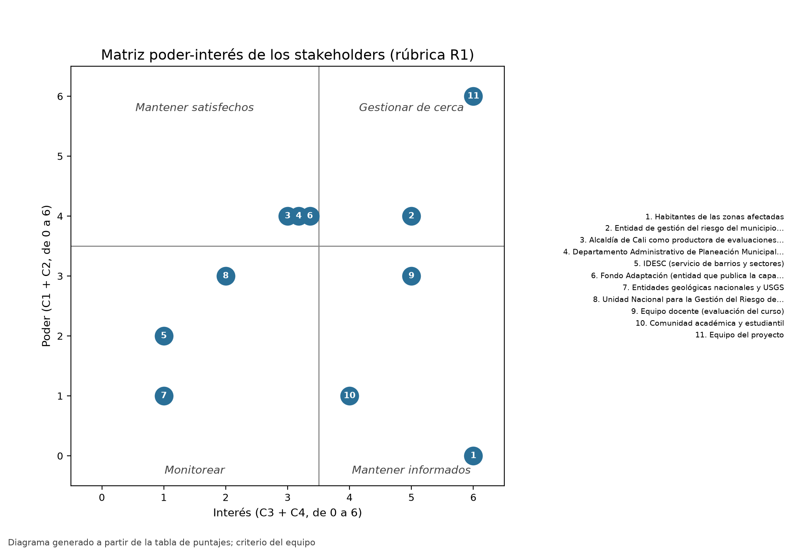

# 2. Mapeo de stakeholders y tipología de la organización

**Ítem del checklist (1.2):** «Realizamos el mapeo de stakeholders (partes interesadas) y comprendimos la tipología de la compañía para adaptar la solución propuesta.» · **Fecha:** 2026-11-12 · Índice: [indice.md](indice.md)

> **Etiquetas de evidencia.** [Evidencia en el repo: `ruta`] = existe en el repositorio; [Fuente externa: URL y fecha de consulta]; [Criterio aplicado: descripción] = regla o decisión nuestra, explicada; [Hipótesis de diseño: criterio y experimento de validación propuesto, no ejecutado] = hipótesis de diseño con su experimento, sin ejecutar. Las cifras se leen de `data/silver`, `data/gold` y `config/config.yaml`.

> **Declaración expresa.** No hubo contacto ni validación con stakeholders; este mapa se construyó con el Avance 1 y fuentes públicas. Los puntajes de la rúbrica R1 son una estimación nuestra con criterio explícito y reproducible, no una medición.

## 1. Tipología de la organización destino y del proyecto
- **Usuarios objetivo (planteamiento, no un cliente real):** una entidad pública territorial de gestión del riesgo (la Secretaría de Gestión del Riesgo de Cali) y la comunidad académica. No hubo contacto con ninguna de ellas. [Criterio aplicado: planteamiento del equipo (supuesto S1)]
- **Naturaleza del proyecto:** investigación aplicada de estudiantes; no es una compañía, no tiene clientes ni ingresos. [Evidencia en el repo: `README.md (autores y curso)`]
- **Tres rasgos que condicionan la solución:**
  1. *Sector público y decisiones de priorización.* El Avance 1 plantea que una entidad de gestión del riesgo podría usar un análisis que cruce fuentes dispersas para priorizar dónde reforzar estudios estructurales; la solución debe decir con claridad qué zonas cubre y cuáles no. [Evidencia en el repo: `docs/proyecto/referencias/contexto_y_problema.pdf, p. 2`; `docs/gold/KPIs.md «Población analizada»`]
  2. *Restricciones de datos abiertos.* La capa satelital es de un tercero y puede cambiar, no hay datos por predio y las licencias difieren; la reproducibilidad descansa en el snapshot de Bronze con su manifiesto y sha256. [Evidencia en el repo: `README.md §5, §6 y §11`; `data/bronze/manifest.jsonl`]
  3. *Cifras sensibles y cambiantes.* Las cifras oficiales cambian a diario; por eso todas las salidas llevan fecha de corte, intervalos y porcentaje sin datos. [Evidencia en el repo: `docs/proyecto/referencias/contexto_y_problema.pdf, p. 1`; `docs/gold/KPIs.md`] Que una mala lectura alarme o dé falsa seguridad es una apreciación nuestra. [Hipótesis de diseño: criterio y experimento de validación propuesto, no ejecutado] Experimento: una prueba de comprensión de los recuadros de alcance con lectores reales.

## 2. Rúbrica R1 (explícita y reproducible)
[Criterio aplicado: rúbrica R1, definida por el equipo] Cada stakeholder recibe cuatro puntajes de 0 a 3:

| criterio | 0 | 1 | 2 | 3 |
|---|---|---|---|---|
| C1 capacidad de decisión sobre el uso de los resultados | ninguna | puede opinar | decide parcialmente | decide el uso |
| C2 control de los datos fuente | ninguno | indirecto | controla parte | produce o controla la fuente |
| C3 impacto recibido por el problema o por el uso de los resultados | ninguno | bajo | medio | alto |
| C4 necesidad de información de nuestro análisis | ninguna | baja | media | alta |

**Poder** = C1 + C2 (0 a 6). **Interés** = C3 + C4 (0 a 6). **Umbral:** un valor es «alto» si es mayor o igual que 4. Cuadrantes: poder y interés altos → *Gestionar de cerca*; poder alto e interés bajo → *Mantener satisfechos*; poder bajo e interés alto → *Mantener informados*; ambos bajos → *Monitorear*.

## 3. Tabla de puntajes y matriz poder-interés
| # | stakeholder | C1 | C2 | C3 | C4 | poder | interés | cuadrante |
|---|---|---|---|---|---|---|---|---|
| 1 | Habitantes de las zonas afectadas | 0 | 0 | 3 | 3 | 0 | 6 | Mantener informados |
| 2 | Entidad de gestión del riesgo del municipio (Secretaría de Gestión del Riesgo de Emergencias y Desastres de la Alcaldía de Cali) | 3 | 1 | 2 | 3 | 4 | 5 | Gestionar de cerca |
| 3 | Alcaldía de Cali como productora de evaluaciones estructurales (ATC-20) | 2 | 2 | 1 | 2 | 4 | 3 | Mantener satisfechos |
| 4 | Departamento Administrativo de Planeación Municipal (DAPM) de Cali | 1 | 3 | 1 | 2 | 4 | 3 | Mantener satisfechos |
| 5 | IDESC (servicio de barrios y sectores) | 0 | 2 | 0 | 1 | 2 | 1 | Monitorear |
| 6 | Fondo Adaptación (entidad que publica la capa satelital) | 1 | 3 | 1 | 2 | 4 | 3 | Mantener satisfechos |
| 7 | Entidades geológicas nacionales y USGS | 0 | 1 | 0 | 1 | 1 | 1 | Monitorear |
| 8 | Unidad Nacional para la Gestión del Riesgo de Desastres (UNGRD; fuente original del RUD) | 1 | 2 | 1 | 1 | 3 | 2 | Monitorear |
| 9 | Equipo docente (evaluación del curso) | 3 | 0 | 2 | 3 | 3 | 5 | Mantener informados |
| 10 | Comunidad académica y estudiantil | 1 | 0 | 1 | 3 | 1 | 4 | Mantener informados |
| 11 | Equipo del proyecto | 3 | 3 | 3 | 3 | 6 | 6 | Gestionar de cerca |

*Diagrama generado a partir de la tabla de puntajes; criterio del equipo.* [Criterio aplicado: rúbrica R1]

| | **interés bajo** (menor que 4) | **interés alto** (4 o más) |
|---|---|---|
| **poder alto** (4 o más) | *Mantener satisfechos:* 3, 4, 6 | *Gestionar de cerca:* 2, 11 |
| **poder bajo** (menor que 4) | *Monitorear:* 5, 7, 8 | *Mantener informados:* 1, 9, 10 |

(Los números remiten a la tabla de puntajes.)

**Estrategia de comunicación propuesta por cuadrante.** [Hipótesis de diseño: criterio y experimento de validación propuesto, no ejecutado] Experimento: preguntar a cada tipo de stakeholder, en una conversación corta, si el canal y el nivel de detalle le sirven.
- *Gestionar de cerca:* entregar el documento de resultados con los recuadros de alcance temporal y población analizada y la tabla «indicador satelital frente a evaluación estructural», y pedir observaciones antes de cualquier uso para decisiones.
- *Mantener satisfechos:* citar y atribuir correctamente cada fuente y licencia (README §17) y avisar del uso de sus datos.
- *Mantener informados:* resumen con los límites por delante, sin presentar cifras de la muestra como si fueran de la ciudad.
- *Monitorear:* revisar periódicamente si publican datos nuevos (un estrato más reciente, datos por predio).

## 4. Stakeholders: rol, necesidad y riesgo
| # | stakeholder | rol y fuente del rol | necesidad de información | relación con nuestros indicadores | riesgo si se interpreta mal |
|---|---|---|---|---|---|
| 1 | Habitantes de las zonas afectadas | Usuario objetivo principal descrito en el Avance 1: quienes viven en las zonas más golpeadas. [Evidencia en el repo: `docs/proyecto/referencias/contexto_y_problema.pdf, p. 2`] | Entender qué se mide, con qué incertidumbre y qué no se puede decir de su barrio. | Tasas por comuna (K6) y por estrato (K1); porcentaje sin datos. | Leer una tasa de la muestra como la probabilidad de que su construcción esté dañada. |
| 2 | Entidad de gestión del riesgo del municipio (Secretaría de Gestión del Riesgo de Emergencias y Desastres de la Alcaldía de Cali) | Segundo grupo de usuarios objetivo del Avance 1: maneja información dispersa y podría priorizar estudios estructurales. [Evidencia en el repo: `docs/proyecto/referencias/contexto_y_problema.pdf, p. 2`] | Dónde hay cambio satelital severo, con qué cobertura y qué zonas no están cubiertas. | K3 (concentración), K6 (comunas), población analizada y alcance temporal. | Priorizar inspecciones solo con el proxy, o ignorar las comunas ausentes, incluida la Comuna 2. |
| 3 | Alcaldía de Cali como productora de evaluaciones estructurales (ATC-20) | Publica balances de predios evaluados con sticker rojo, amarillo y verde; son contexto externo. [Evidencia en el repo: `README.md «Indicador satelital frente a evaluación estructural»`] [Fuente externa: https://www.elpais.com.co/cali/alcaldia-de-cali-entrega-balance-de-gestion-tras-el-sismo-mas-de-3400-edificaciones-evaluadas-y-45000-familias-damnificadas-2338.html, consulta del 15-oct-2026 registrada en docs/bronze/investigacion_fuentes.md] | Que nuestro indicador no se confunda con su evaluación y que predios y construcciones no se mezclen. | Ninguna: no comparamos ni mezclamos sus cifras con Gold. | Presentar el proxy como sustituto de la evaluación estructural. |
| 4 | Departamento Administrativo de Planeación Municipal (DAPM) de Cali | Publica el estrato por barrio 2015 (lados de manzana). [Evidencia en el repo: `README.md §5.2`] | Qué uso se hace del estrato 2015 y de sus códigos, y con qué desfase. | K1, K2, K4 (usan el estrato); K5 (cobertura de la llave). | Atribuir al estrato vigente un resultado que usa el de 2015. |
| 5 | IDESC (servicio de barrios y sectores) | Publica los polígonos de barrios 2026 que usamos solo para validar la llave. [Evidencia en el repo: `README.md §5.3`] | Qué códigos de polígono corresponden a qué códigos de 2015. | K5 (nombre validado) y la revisión de códigos de barrio. | Concluir que un código distinto significa un barrio distinto (hay renumeración). |
| 6 | Fondo Adaptación (entidad que publica la capa satelital) | Publicadora de la capa «Impacto Satelital en Edificaciones por Terremoto. Cali 2026». [Evidencia en el repo: `README.md §5.1`] | Que el proxy se describa con su método, fechas de imágenes y límites. | Todos los KPI (el severo estricto sale de su clasificación). | Atribuirle conclusiones de daño que la capa no hace. |
| 7 | Entidades geológicas nacionales y USGS | El Avance 1 las lista como fuente del contexto técnico; el README usa USGS solo como contexto. [Evidencia en el repo: `docs/proyecto/referencias/contexto_y_problema.pdf, p. 4`; `README.md §5.4`] | Que el evento (magnitud, fecha) se cite correctamente. | Ninguna (contexto del evento). | Mezclar la intensidad o la magnitud con nuestros KPI sin llave espacial. |
| 8 | Unidad Nacional para la Gestión del Riesgo de Desastres (UNGRD; fuente original del RUD) | Fuente original de los datos municipales de daños del plan B; la ruta usada es un monitor de un solo mantenedor. [Evidencia en el repo: `docs/bronze/investigacion_fuentes.md (ficha 8)`] | Que el plan B (municipal) quede documentado y no se confunda con el plan elegido. | Ninguna: el plan elegido no usa esta fuente. | Citar datos del monitor como oficiales. |
| 9 | Equipo docente (evaluación del curso) | Evalúa la entrega; no es un usuario del análisis. [Evidencia en el repo: `docs/retroalimentacion/retroalimentacion_recibida.txt`] | Reproducibilidad, trazabilidad, honestidad sobre límites y evidencia verificable. | KPI de desempeño del proyecto (documento 03) y criterios del MVP (documento 05). | Entender que se validó con usuarios o stakeholders cuando no ocurrió. |
| 10 | Comunidad académica y estudiantil | Tercer grupo de usuarios objetivo del Avance 1. [Evidencia en el repo: `docs/proyecto/referencias/contexto_y_problema.pdf, p. 2`] | Entender con datos, y no solo con narrativas, qué factores explican lo ocurrido. | K1, K2, K4 y sensibilidades. | Leer la ausencia de diferencia como ausencia de efecto del estrato. |
| 11 | Equipo del proyecto | Diseña, construye y documenta el análisis; responde por sus límites. [Evidencia en el repo: `README.md (autores)`] | Saber qué falta validar antes de afirmarlo. | Todos. | Afirmar sin respaldo lo que es una hipótesis. |

## 5. Cómo adaptamos la solución a cada tipo de stakeholder
| tipo | qué se entrega | advertencias que siempre acompañan |
|---|---|---|
| Usuario objetivo institucional (gestión del riesgo) | `README.md`, `docs/gold/KPIs.md`, las tablas de `data/gold/` y la API de solo lectura; el dashboard está en construcción [Evidencia en el repo: `README.md`; `docs/gold/KPIs.md`; `data/gold/kpis_gold.csv`] | Población analizada (7 comunas), alcance temporal (estrato 2015), proxy y no evaluación estructural, porcentaje sin datos. |
| Habitantes | Nada específico hoy; podría ser un resumen en lenguaje sencillo. [Hipótesis de diseño: criterio y experimento de validación propuesto, no ejecutado] Experimento: prueba de comprensión con lectores. | Las tasas no son prevalencias ni la probabilidad de que una construcción concreta esté dañada. |
| Productores de datos (DAPM, IDESC, Fondo Adaptación, UNGRD, USGS) | Atribución y licencias en `README.md` §17 y trazabilidad por sha256 [Evidencia en el repo: `README.md §17`] | Las limitaciones de sus datos (estrato 2015, polígonos 2026 renumerados) no son un juicio sobre su calidad. |
| Comunidad académica y equipo docente | Repositorio ejecutable, 998 pruebas, registro de decisiones y verificación de entrega [Evidencia en el repo: `docs/DECISIONES.md`; `docs/validacion/verificacion_del_paquete.md`; `tests/`] | No hubo pruebas con usuarios. |

## 6. Contactos realizados
**Ninguno:** este mapa se construyó con el Avance 1 y fuentes públicas. Si más adelante ocurre un contacto, se registra aquí con fecha, rol de la persona, qué se habló y dónde está el registro; sin registro no se afirma nada.

| fecha | con quién (rol) | qué se habló | dónde está el registro |
|---|---|---|---|
| Ninguno | Ninguno | Ninguno | Ninguno |

### Protocolo de validación (no ejecutado)
Cinco preguntas por tipo de stakeholder, para una conversación de 15 minutos con consentimiento. [Hipótesis de diseño: criterio y experimento de validación propuesto, no ejecutado]
- **Usuario objetivo institucional:** (1) ¿Qué decisiones de priorización toma hoy y con qué información? (2) ¿Qué le faltaría a una tabla por comuna para usarla? (3) ¿Qué advertencias necesitaría ver? (4) ¿Con qué frecuencia necesitaría actualizarla? (5) ¿Qué haría diferente si supiera que el estrato es de 2015?
- **Habitantes:** (1) ¿Qué pregunta querría responder sobre su barrio? (2) ¿Qué entiende por «cambio satelital severo»? (3) ¿Qué conclusión sacaría de la tasa de su comuna? (4) ¿Qué le generaría desconfianza? (5) ¿Por qué canal preferiría informarse?
- **Productores de datos:** (1) ¿Cómo prefieren que se cite su dato? (2) ¿Hay una versión más reciente? (3) ¿Qué límites del dato no son evidentes? (4) ¿Existe un código de correspondencia entre 2015 y 2026? (5) ¿Qué uso consideran indebido?
- **Comunidad académica:** (1) ¿Qué comparación faltaría? (2) ¿Qué sensibilidad adicional pediría? (3) ¿Qué entiende de «no se detecta diferencia»? (4) ¿Reproduciría el análisis con el README? (5) ¿Qué dato adicional haría falta?

## Alcance y límites
- **Qué afirmamos:** identificamos 11 stakeholders y los ordenamos con una rúbrica de cuatro criterios que cualquiera puede recalcular; el planteamiento de usuario objetivo y su tipología son un diseño del equipo.
- **Con qué evidencia:** la tabla de puntajes, la matriz generada a partir de ella y las fuentes de cada rol.
- **Qué NO afirmamos:** que hablamos con alguien, que alguna entidad usa o pidió el análisis o que los puntajes son una medición.

## Preguntas frecuentes
- **«¿Hablaron con la Secretaría de Gestión del Riesgo?»** No; el campo de contactos dice «Ninguno» y dejamos un protocolo de cinco preguntas por tipo de stakeholder para cuando se haga.
