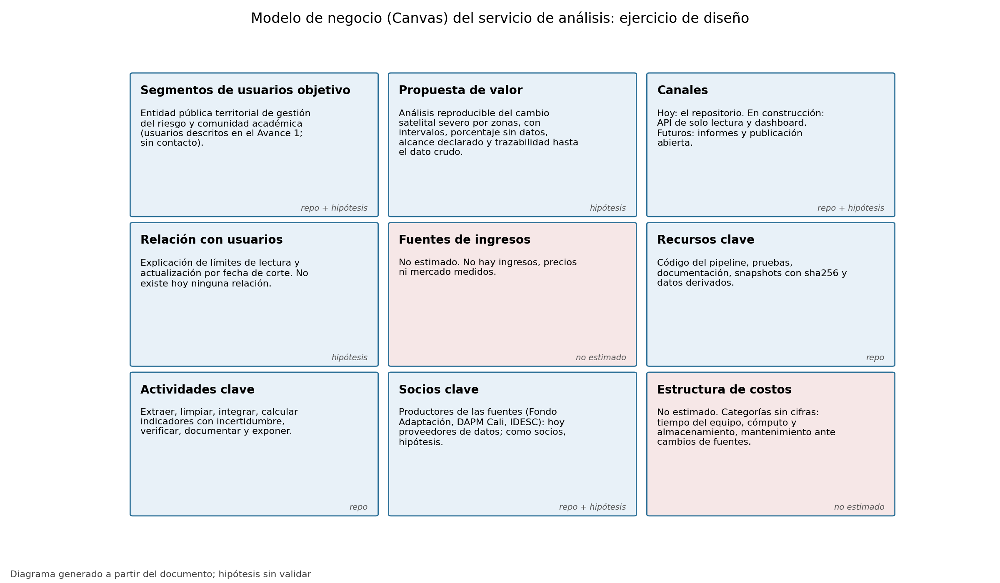

# 4. Modelo de negocio (Canvas), propuesta de valor y Data Innovation Board

**Ítem del checklist (1.4):** «Estructuramos el Modelo de Negocio (CANVAS), Data Innovation Board y la propuesta de valor con enfoque de creación de Startups de AI/Datos.» · **Fecha:** 2026-11-12 · Índice: [indice.md](indice.md)

> **Aviso.** Este documento es un ejercicio de diseño con hipótesis sin validar. No hay clientes, usuarios ni mercado medidos, no hubo entrevistas ni pruebas con nadie, y no estimamos ingresos, precios ni costos: cuando aparecen escribimos «no estimado». Nada de lo que sigue debe leerse como un plan de negocio validado.

> **Etiquetas de evidencia.** [Evidencia en el repo: `ruta`] = existe en el repositorio; [Fuente externa: URL y fecha de consulta]; [Criterio aplicado: descripción] = regla o decisión nuestra, explicada; [Hipótesis de diseño: criterio y experimento de validación propuesto, no ejecutado] = hipótesis de diseño con su experimento, sin ejecutar. Las cifras se leen de `data/silver`, `data/gold` y `config/config.yaml`.

## 1. Concepto de producto (hipótesis)
Un servicio de análisis reproducible de impacto sísmico por zonas, con incertidumbre explícita, que incluye: pipeline de datos, **API de solo lectura** (implementada), **almacenamiento relacional con historial** (en construcción), **orquestación programada** (en construcción) y **dashboard** (en construcción). [Hipótesis de diseño: criterio y experimento de validación propuesto, no ejecutado] Experimento: ver los supuestos críticos de la sección 5.

Lo que existe hoy es el pipeline, sus indicadores y su documentación para 5.146 construcciones de 7 comunas. [Evidencia en el repo: `README.md`; `data/gold/`; `docs/proyecto/decisiones_tecnicas.md`] Los demás componentes están decididos, no construidos.

## 2. Modelo de negocio (Canvas)
| bloque | contenido | base |
|---|---|---|
| 1. Segmentos de usuarios objetivo | Entidad pública territorial de gestión del riesgo y comunidad académica (usuarios descritos en el Avance 1; sin contacto). | repo + hipótesis |
| 2. Propuesta de valor | Análisis reproducible del cambio satelital severo por zonas, con intervalos, porcentaje sin datos, alcance declarado y trazabilidad hasta el dato crudo. | hipótesis |
| 3. Canales | Hoy: el repositorio. En construcción: API de solo lectura y dashboard. Futuros: informes y publicación abierta. | repo + hipótesis |
| 4. Relación con usuarios | Explicación de límites de lectura y actualización por fecha de corte. No existe hoy ninguna relación. | hipótesis |
| 5. Fuentes de ingresos | No estimado. No hay ingresos, precios ni mercado medidos. | no estimado |
| 6. Recursos clave | Código del pipeline, pruebas, documentación, snapshots con sha256 y datos derivados. | repo |
| 7. Actividades clave | Extraer, limpiar, integrar, calcular indicadores con incertidumbre, verificar, documentar y exponer. | repo |
| 8. Socios clave | Productores de las fuentes (Fondo Adaptación, DAPM Cali, IDESC): hoy proveedores de datos; como socios, hipótesis. | repo + hipótesis |
| 9. Estructura de costos | No estimado. Categorías sin cifras: tiempo del equipo, cómputo y almacenamiento, mantenimiento ante cambios de fuentes. Detalle de categorías y fórmulas con precios como parámetros vacíos: [docs/finanzas/estructura_costos.md](../finanzas/estructura_costos.md). | no estimado |

*Diagrama generado a partir del documento; hipótesis sin validar.*

## 3. Propuesta de valor
### 3.1 Perfil del usuario objetivo
| elemento | contenido | etiqueta |
|---|---|---|
| Trabajos | Priorizar dónde reforzar estudios estructurales o dónde concentrar esfuerzos de prevención. | [Evidencia en el repo: `docs/proyecto/referencias/contexto_y_problema.pdf, p. 2`] |
| Trabajos | Responder con evidencia por qué un barrio resultó más afectado que otros cercanos. | [Evidencia en el repo: `docs/proyecto/referencias/contexto_y_problema.pdf, p. 2`] |
| Frustraciones | La información de daños y de amenaza existe, pero dispersa. | [Evidencia en el repo: `docs/proyecto/referencias/contexto_y_problema.pdf, p. 2`] |
| Frustraciones | Las cifras oficiales cambian a diario y se responden preguntas con rumores o supuestos. | [Evidencia en el repo: `docs/proyecto/referencias/contexto_y_problema.pdf, p. 1-2`] |
| Frustraciones | No sabemos cuáles de estas frustraciones sienten de verdad los usuarios. | [Hipótesis de diseño: criterio y experimento de validación propuesto, no ejecutado] Experimento: H1 y H4. |
| Beneficios esperados | Decidir con indicadores que digan cuánta muestra tienen detrás y qué zonas no cubren. | [Hipótesis de diseño: criterio y experimento de validación propuesto, no ejecutado] Experimento: H2. |
| Beneficios esperados | Poder repetir el análisis cuando haya un corte nuevo o un estrato más reciente. | [Hipótesis de diseño: criterio y experimento de validación propuesto, no ejecutado] Experimento: H6. |

### 3.2 Mapa de valor ligado a capacidades reales
| elemento | contenido | capacidad (ruta) |
|---|---|---|
| Producto o servicio | Pipeline medallion y tablas Gold con K1 a K6 y sensibilidades | [Evidencia en el repo: `src/`; `data/gold/kpis_gold.csv`; `data/gold/kpis_sensibilidad.csv`] |
| Producto o servicio | API, almacén relacional, orquestación y dashboard (en construcción) | [Evidencia en el repo: `docs/proyecto/decisiones_tecnicas.md`] |
| Aliviador de frustraciones | Fuentes cruzadas por una llave verificada, con huérfanos conservados | [Evidencia en el repo: `data/silver/silver_orphans_left.csv`; `docs/silver/validacion_llave.md`; `docs/silver/revision_codigos_barrio.md`] |
| Aliviador de frustraciones | Cada cifra lleva fecha de corte y trazabilidad al dato crudo | [Evidencia en el repo: `data/bronze/manifest.jsonl`; `docs/gold/KPIs.md`] |
| Creador de beneficios | Incertidumbre declarada: intervalos de Wilson y Newcombe, cotas por falta de datos y seis escenarios | [Evidencia en el repo: `docs/gold/KPIs.md`; `data/gold/kpis_sensibilidad.csv`] |
| Creador de beneficios | Límites de población y de alcance temporal visibles | [Evidencia en el repo: `docs/gold/KPIs.md «Población analizada» y «Alcance temporal»`] |
| Creador de beneficios | Verificación automática y repetibilidad | [Evidencia en el repo: `tests/`; `docs/evidencias/estrategia/EV-009_determinismo_clon.txt`] |

## 4. Data Innovation Board
| elemento | contenido |
|---|---|
| Problema de negocio | Falta de un análisis público y verificable que explique el patrón de daño por zonas y por estrato. [Evidencia en el repo: `docs/proyecto/referencias/contexto_y_problema.pdf, p. 3`] |
| Decisión que apoya | Priorizar dónde hacer o profundizar estudios estructurales y de prevención. [Hipótesis de diseño: criterio y experimento de validación propuesto, no ejecutado] Experimento: H2. |
| Datos actuales | Capa satelital por construcción (Fondo Adaptación, 5.146 filas), estrato por barrio 2015 (DAPM Cali), polígonos de barrios (IDESC, 342 polígonos) y contexto del evento (USGS). [Evidencia en el repo: `README.md §5`; `data/bronze/manifest.jsonl`] |
| Datos que faltan | Evaluaciones estructurales por predio en una fuente descargable; estrato actualizado; amenaza sísmica oficial; antigüedad constructiva por construcción; las comunas ausentes, entre ellas la Comuna 2. [Evidencia en el repo: `README.md §17`; `docs/proyecto/comprension_proyecto1.md`] |
| Enfoque analítico actual | Estadística descriptiva e inferencial sobre un proxy satelital: tasas con intervalo de Wilson, diferencia con intervalo de Newcombe, razón de Mantel-Haenszel, Spearman con permutación y sensibilidades. **No entrenamos modelos de aprendizaje automático.** [Evidencia en el repo: `README.md §9`; `docs/gold/KPIs.md`; `src/transform/build_gold.py`] |
| Enfoques futuros con inteligencia artificial (no hechos) | Visión por computador sobre las imágenes para una medida propia de cambio en lugar de depender de la clasificación de un tercero (H10); aprendizaje supervisado para estimar vulnerabilidad si existiera una fuente de evaluación por predio con permiso de uso. Ambos requieren datos que hoy no tenemos. [Hipótesis de diseño: criterio y experimento de validación propuesto, no ejecutado] |
| Usuarios | Entidad pública de gestión del riesgo y comunidad académica (Avance 1; sin contacto). [Evidencia en el repo: `docs/proyecto/referencias/contexto_y_problema.pdf, p. 2`] |
| Valor esperado (cualitativo) | Menos supuestos en la conversación sobre dónde mirar primero y una base reproducible para actualizar. No estimado en términos económicos. [Hipótesis de diseño: criterio y experimento de validación propuesto, no ejecutado] |
| Riesgos y ética | *Sesgo de selección:* solo hay construcciones dentro de los polígonos de afectación preliminar y 7 comunas. [Evidencia en el repo: `docs/gold/KPIs.md «Población analizada»`] *Uso indebido:* priorizar inspecciones solo con el proxy y sin evaluación técnica. [Hipótesis de diseño: criterio y experimento de validación propuesto, no ejecutado] *Privacidad:* `gold_final.csv` no trae nombres de propietarios ni identificadores de predio (`ID_PREDIO` se descarta), pero sí coordenadas de cada construcción. [Evidencia en el repo: `docs/validacion/verificacion_entrega.md`; `data/gold/gold_final.csv`] *Estigmatización de zonas* por una tasa sin contexto. [Hipótesis de diseño: criterio y experimento de validación propuesto, no ejecutado] |
| Recursos y capacidades | Código en Python, pruebas, documentación y conocimiento de las fuentes; sin recursos económicos definidos (no estimado). [Evidencia en el repo: `requirements.txt`; `src/`; `tests/`] |
| Métricas de éxito | Las de desempeño del proyecto y las métricas de valor del documento 03; las de adopción y uso no están definidas ni medidas. [Evidencia en el repo: `docs/estrategia/03_objetivo_alcance_okr_kpi.md §3`] |
| Hoja de ruta de validación | Validar primero la necesidad con usuarios reales (H1, H4), luego comparar el proxy con evaluaciones por predio (H3) y la disponibilidad de datos (H5). Ninguno está ejecutado. [Hipótesis de diseño: criterio y experimento de validación propuesto, no ejecutado] |

## 5. Hipótesis y supuestos críticos
Cada hipótesis tiene base de evidencia, nivel de confianza (alta, media o baja), criterio de refutación y experimento propuesto. **Ningún experimento está ejecutado.** Los números de personas son tamaños de muestra propuestos, no cifras de mercado. Eliminamos las hipótesis sin base alguna (por ejemplo, disposición de pago, tamaño de mercado o financiación) en lugar de dejarlas como supuestos.

| id | hipótesis | base de evidencia | confianza | criterio de refutación | experimento propuesto (no ejecutado) |
|---|---|---|---|---|---|
| H1 | Una entidad de gestión del riesgo necesita un análisis por zonas con incertidumbre explícita. | El Avance 1 describe información dispersa y priorización de estudios. [Evidencia en el repo: `docs/proyecto/referencias/contexto_y_problema.pdf, p. 2`] | media | Dicen que ya cuentan con ese análisis o que no lo usarían. | Entrevistas estructuradas con 3 a 5 personas de entidades de gestión del riesgo. |
| H2 | K3 y K6 sirven para decidir dónde mirar primero. | K3 y K6 existen y están definidos. [Evidencia en el repo: `docs/gold/KPIs.md`] | baja | Las zonas que sugieren no coinciden con las que el personal técnico considera prioritarias. | Mostrar K3 y K6 a personal técnico y comparar con su criterio. |
| H3 | El cambio satelital severo se relaciona con la evaluación estructural. | Es el supuesto del proxy; sin cruce posible hoy. [Evidencia en el repo: `README.md «Indicador satelital frente a evaluación estructural»`] | baja | Asociación débil o nula al cruzar con evaluaciones por predio. | Con datos por predio disponibles, cruzar el severo estricto con el sticker ATC-20 en una muestra. |
| H4 | Los lectores entienden que las tasas no son prevalencias de Cali. | Los recuadros de alcance existen. [Evidencia en el repo: `README.md`; `docs/gold/KPIs.md`] | media | Muchos lectores las leen como probabilidades de la ciudad. | Prueba de comprensión con 5 a 8 lectores sobre los recuadros. |
| H5 | Habrá datos futuros utilizables (estrato más reciente, datos por predio) con licencia. | El estrato de 2015 es el único disponible hoy. [Evidencia en el repo: `docs/bronze/investigacion_fuentes.md`] | baja | No hay datos nuevos o no hay permiso de uso. | Solicitud formal de datos a los productores. |
| H6 | Un análisis repetible por corte vale más que uno puntual. | El pipeline se repite con los mismos hashes. [Evidencia en el repo: `docs/evidencias/estrategia/EV-009_determinismo_clon.txt`] | media | A los usuarios les basta un informe único. | Preguntar a posibles usuarios si pedirían actualizaciones y con qué frecuencia. |
| H7 | Mantener el pipeline ante cambios de la fuente es viable para el equipo. | Hay `--refresh` y snapshots inmutables. [Evidencia en el repo: `README.md §6`] | media | Un cambio de esquema rompe la limpieza sin aviso. | Repetir la extracción con `--refresh` (necesita red) y comparar los snapshots. |
| H8 | Publicar el código y los datos derivados con atribución es compatible con las licencias de las fuentes. | Las licencias están documentadas (CC BY 4.0 para la capa; el CSV figura como CC BY-SA y como CC0 según el portal). [Evidencia en el repo: `README.md §5.1 y §5.2`; `docs/DECISIONES.md`] | media | Un productor indica que sus términos no permiten la redistribución derivada. | Revisar los términos de cada fuente y consultar a los productores, sin comprometer cifras. |
| H9 | Una API y un dashboard facilitan el uso frente a los archivos CSV. | Hoy solo hay CSV y notebooks. [Evidencia en el repo: `data/gold/`; `notebooks/`] | media | Los usuarios prefieren la tabla descargable. | Sesiones de uso del dashboard con tareas definidas (Usuarios, UX y finanzas, no ejecutadas). |
| H10 | Visión por computador sobre las imágenes mejoraría la medida del cambio. | La capa ya clasifica por cambio de textura entre dos imágenes; es un enfoque futuro. [Evidencia en el repo: `README.md §5.1`] | baja | No supera la clasificación existente en una muestra con evaluación por predio. | Con imágenes y etiquetas por predio, comparar un modelo con el severo estricto. |

## 6. Qué no afirmamos
- Que haya usuarios, entrevistas, pruebas de usabilidad o validación de cualquier tipo.
- Que alguna entidad pidió, usa o respalda este análisis.
- Cifras de mercado, precios, ingresos, costos, número de usuarios o disposición de pago: no estimado.
- Que el proyecto sea una startup, tenga plan comercial o esté listo para operar como servicio.
- Que usemos aprendizaje automático o inteligencia artificial: lo que hicimos es estadística descriptiva e inferencial.
- Que el proxy satelital sustituya una evaluación estructural.
- Que el Canvas, la propuesta de valor o el Data Innovation Board estén validados.

## 7. Nota sobre la plantilla del curso
Si el curso entrega una plantilla propia de Data Innovation Board o de Canvas, nuestra estructura es el contenido y se adapta al formato de esa plantilla; no hay una plantilla del curso disponible en el material que revisamos.

## Alcance y límites
- **Qué afirmamos:** estructuramos Canvas, propuesta de valor y Data Innovation Board como un ejercicio de diseño, con diez hipótesis, su base de evidencia, su nivel de confianza y un experimento propuesto para cada una.
- **Con qué evidencia:** las capacidades reales citadas con su ruta y el Avance 1 para los trabajos y frustraciones del usuario objetivo.
- **Qué NO afirmamos:** que haya mercado, usuarios, ingresos o validación; los ingresos y costos son «no estimado».

## Preguntas frecuentes
- **«¿Cuál es el modelo de negocio y quién pagaría?»** El documento es un ejercicio de diseño con hipótesis sin validar; no estimamos ingresos y proponemos experimentos (H1, H5) para saber si existe una vía de financiación.
