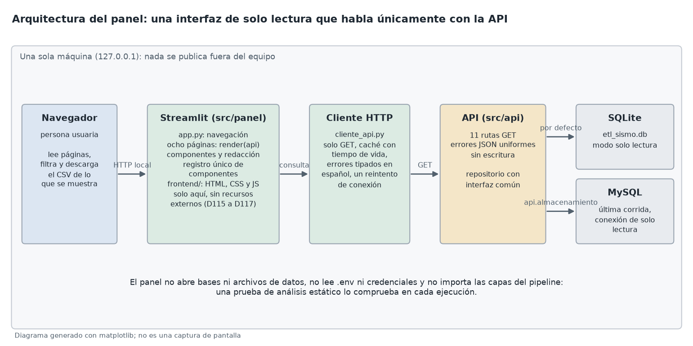

# Arquitectura del panel

Diagrama generado con matplotlib (`python scripts/panel/make_arquitectura_panel.py`); no es una captura de pantalla.

## 1. Capas y módulos
| Módulo (`src/panel/`) | Responsabilidad |
|---|---|
| `app.py` | aplicación Streamlit: `st.set_page_config` y `st.navigation` (oculta) con las ocho páginas del registro (D68); la barra lateral la dibuja `frontend/navegacion.py` (D115) |
| `frontend/` | la interfaz propia del diseño aprobado (D115, D116 y D117): `vista.py` (piezas compartidas: cabecera, glosario, figura de tasas, tablas, tarjetas y documento exportable), `respuesta.py`, `estratos.py`, `comunas.py` y `sensibilidades.py` (lo propio de cada página; las otras cuatro usan solo las piezas compartidas desde sus páginas), `lectura.py` y `lectura.js` (guía, curiosidades, aviso y modo presentación), `navegacion.py`, `marco.py`, `estilos.py`, `activos.py` (único lector de sus recursos) y los CSS, SVG, plantillas, textos de apoyo e imágenes; es el único lugar de `src/panel/` con HTML, CSS y JavaScript propios; la usan las ocho páginas |
| `registro.py` | definición única, de solo datos, de páginas y componentes (ruta de la API, campo, archivo de salida, KPI y advertencia) |
| `cliente_api.py` | único punto de acceso a los datos: GET por HTTP, resultado tipado, un reintento de conexión y caché con tiempo de vida (D69 y D70) |
| `configuracion.py` | lee solo la clave `panel` de `config/config.yaml`; acepta `PANEL_API_URL` solo si es una dirección local |
| `formato.py` | cifras con coma decimal, punto de miles, signo menos y redondeo half-up |
| `redaccion.py` | conclusiones generadas con la regla de `docs/gold/KPIs.md` (D73) |
| `componentes.py` | marco común, recuadro de alcance, tarjetas, tablas y gráficos Altair (D71, D74 y D75) |
| `glosario.py` | un solo diccionario de términos técnicos y la lista de los que usa cada página; desde D115 lo muestra la cabecera propia de cada página, cerrado (antes era un desplegable al final, D88) |
| `tema.py` y `claves.py` | colores y relación de contraste; identificadores de KPI, grupos y escenarios |
| `paginas/` | una función `render(api)` por página, sin efectos al importarse |

## 2. Flujo de una consulta
1. La persona abre una página en el navegador; Streamlit ejecuta la función `render` de esa página.
2. La página pide cada dato con `api(ruta, **parámetros)`; el cliente hace un GET a la API y, si sale bien, guarda la respuesta en la caché por el tiempo configurado.
3. La API lee el repositorio del almacenamiento activo (SQLite por defecto o MySQL, según `api.almacenamiento`) en solo lectura y responde en JSON.
4. La página da formato a las cifras, genera las lecturas y dibuja tablas y gráficos.

## 2.1 Errores y degradación
Cada fallo se traduce a un aviso en español: API apagada, tiempo agotado, almacenamiento no disponible (503), recurso inexistente (404), parámetros inválidos (422) o respuesta con un formato inesperado. El marco de cada página mantiene visible el recuadro de alcance y no muestra trazas ni rutas.

## 3. Seguridad y aislamiento
- **Solo lectura:** el cliente solo usa GET; la API rechaza cualquier otro método (405).
- **Sin acceso a datos ni credenciales:** el panel no importa `sqlite3`, `pymysql` ni las capas del pipeline, no abre CSV ni bases, no lee `.env` y el lanzador no le pasa variables `MYSQL_*`. Una prueba de análisis estático lo comprueba en cada ejecución.
- **Sin recursos externos:** no usa `unsafe_allow_html`, mapas con teselas ni fuentes de red; la telemetría de Streamlit está desactivada.
- **HTML, CSS y JavaScript propios solo en `src/panel/frontend/` (D115):** todo texto de los datos se escapa en Python; el único JavaScript (`lectura.js`) escribe con `textContent`, no asigna HTML, no evalúa código, no sale a la red y tiene su huella fijada en `tests/test_panel_frontend.py`. Las ocho páginas usan esta capa; las tablas, los avisos, los filtros y el gráfico de ubicación y el de diferencias siguen siendo componentes nativos dentro del contenedor del diseño.
- **Solo local:** el panel y la API escuchan en 127.0.0.1 y el cliente rechaza direcciones que no sean locales.

## 4. Decisiones relacionadas
D20 (Streamlit sobre la API), D23 y D67 (pruebas de integración), D68 a D80 (panel), D87 a D90 (ajustes tras la evaluación heurística), D115, D116 y D117 (interfaz propia en `frontend/`).

## 4.1 Riesgos conocidos de la interfaz propia (D115 a D117)
- **Ejes adaptables:** el eje horizontal de las figuras de tasas se calcula con los datos (el menor múltiplo de un paso redondo que cubre el mayor límite superior, con a lo sumo seis tramos: hoy llega a 30 % en Estratos y a 20 % en Comunas) y el del informe de Sensibilidades incluye el cero y cubre los límites (hoy de −5 a 10 pp). Con un corte nuevo la escala puede cambiar: **dos capturas de cortes distintos no son comparables a simple vista**; lo que no cambia es el valor de cada número, que sale de la API.
- **Selectores internos de Streamlit:** el JavaScript busca el contenedor por la clase `.st-key-lienzo` (la clave `lienzo` del contenedor de cada página) y el CSS usa `:has()`, `[data-testid="stSidebar"]`, `stMainBlockContainer` y las clases `.st-key-*` de los contenedores con clave; son detalles internos, no una interfaz pública. La versión de Streamlit está fijada en 1.67.0 y una prueba comprueba que la clave exista; con una versión nueva hay que volver a recorrer las ocho páginas en el navegador (EV-124).
- **El JavaScript y el estilo no se ejecutan en las pruebas automáticas** (`AppTest`): la interacción y el aspecto se comprueban con el recorrido en el navegador y las capturas (EV-124 a EV-126), que no sustituyen una revisión con personas usuarias.
- **Las evidencias históricas conservan lo que mostraban:** las capturas y los registros anteriores a D115 (EV-054, EV-073 a EV-081 y las guías de las sesiones simuladas) describen el panel de componentes nativos.

## 5. Alcance y límites
- **Qué afirmamos:** el panel es una capa de presentación delgada: toda cifra viene de la API y toda conclusión se genera con una regla.
- **Qué NO afirmamos:** que escale a muchas personas a la vez (una conexión a MySQL por solicitud de la API) ni que esté desplegado; es un panel local.
