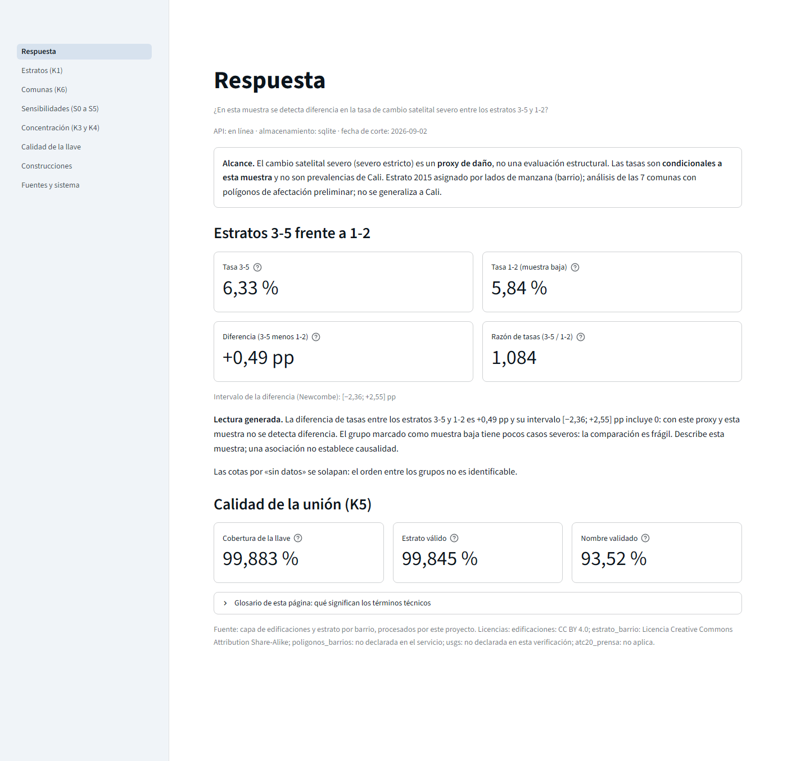

{{para: todos}}
{{sin-salto}}
# Parte B · Primera vez con el panel

El panel es la pantalla del proyecto que usará en su sesión: ocho páginas con los resultados del análisis. Esta parte solo le enseña a **arrancarlo, moverse entre sus páginas y cerrarlo**. No le explica qué dicen las páginas, porque eso es justo lo que la sesión quiere saber: si usted lo entiende sin que se lo cuenten. Por eso, aquí **no lea el contenido de las páginas**; basta con comprobar que cada una abre.

## B1. Arranque el panel
Con la carpeta del proyecto abierta en PowerShell (paso A3), escriba:
```powershell
.\.venv\Scripts\python.exe scripts\panel\ejecutar_panel.py
```
Un comando arranca los dos programas que hacen falta: la API (que sirve los datos) y el panel (lo que usted ve). Tarda unos 5 segundos y escribe cuatro líneas parecidas a estas:
```text
API:   http://127.0.0.1:8000  (documentación en http://127.0.0.1:8000/docs)
Panel: http://127.0.0.1:8501
Almacenamiento de la API: sqlite
Ctrl+C para cerrar los dos procesos.
```
Si el puerto 8000 o el 8501 está ocupado, el lanzador elige otro y lo escribe: use siempre el número que aparece en su pantalla. **La ventana de PowerShell debe quedar abierta mientras use el panel.**

## B2. Ábralo en el navegador
Copie la dirección de la línea que empieza por `Panel:` y péguela en Edge o Chrome. Maximice la ventana del navegador: en la sesión se usa una ventana de unos 1400 píxeles de ancho. El panel funciona solo en su equipo (`127.0.0.1`): nadie más puede verlo.

La dirección de la API (`:8000`) no tiene página en la raíz: `http://127.0.0.1:8000/` responde «404 No se encontró», y eso es lo normal. Si quiere comprobarla, abra `http://127.0.0.1:8000/health`: debe decir `"estado":"ok"`.

## B3. Cómo saber que todo salió bien
**Primero.** A la izquierda hay un menú con **ocho páginas**. Debe verse así (el recorte muestra solo el menú):

{recorte=0,60,300,300}

**Segundo.** Arriba de cada página hay una línea de estado que debe decir **«API: en línea»**, el almacenamiento `sqlite` y una fecha de corte:

{recorte=380,222,430,26}

**Tercero.** Si en lugar de eso ve un aviso en español que dice que la API no responde, actualice la página (Ctrl+R). Un fallo no queda guardado.

Las capturas son del panel real, tomadas por el navegador automatizado del proyecto (`docs/evidencias/ajustes_ux/EV-077_captura_respuesta_1400.png`); la fecha de corte y el resto cambian solo si cambian los datos.

## B4. Muévase entre las páginas
Haga clic en el nombre de una página del menú para abrirla. Las ocho son, en este orden: **Respuesta, Estratos (K1), Comunas (K6), Sensibilidades (S0 a S5), Concentración (K3 y K4), Calidad de la llave, Construcciones y Fuentes y sistema**.

Ahora abra cada una **solo para ver que carga** (no hace falta leerla) y vuelva a la primera, **Respuesta**. Todas deben abrir sin un aviso de error. **Algunas muestran cuadros azules con texto: no son errores**, son notas de la propia página; un error es un mensaje en rojo o un aviso que dice que la API no responde. Al final de cada página hay un desplegable cerrado que se llama «Glosario de esta página»: sirve para consultar un término, y puede usarlo en cualquier momento.

Los botones de las tablas y los gráficos («Download as CSV», «Fullscreen», «Search») salen en inglés: la versión de Streamlit que fijamos no permite traducirlos (`docs/panel/guia_de_uso.md`).

## B5. Ciérrelo
Vuelva a la ventana de PowerShell y presione **Ctrl+C**. El lanzador cierra la API y el panel (lo probamos: se cerró en 1 s y no quedó ningún proceso). Cierre también la pestaña del navegador.

Si la ventana de PowerShell se cerró y el panel sigue respondiendo, busque qué programa usa el puerto y ciérrelo:
```powershell
Get-NetTCPConnection -LocalPort 8501 -State Listen | Select-Object OwningProcess
Stop-Process -Id <número que aparece>
```
Al cerrar el panel, el lanzador cierra también la API (en nuestra prueba, en menos de 3 s); si el puerto 8000 sigue abierto, repita lo mismo con ese número de puerto.

## B6. Si algo falla
{{incluir: docs/panel/guia_de_uso.md#4-avisos-y-errores}}

Si no es un aviso del panel sino un error al arrancar, vuelva a la tabla de errores de la parte A (A7). Una dificultad para arrancar o instalar **no se anota como fricción de usabilidad**.
